# Calories

Aplicativo Android pessoal de planejamento alimentar, controle nutricional e acompanhamento de dieta. Funciona offline, sem conta e sem servidor; os dados ficam no aparelho.

> **APK:** [`release/Calories-0.4.0.apk`](release/Calories-0.4.0.apk). Versão 0.4.0 (Fase 4), assinado, 2,2 MB, Android 8.0 ou superior. Feito para o Galaxy S26 (Android 16).
>
> SHA-256: `3fab9684c4ee22e636342acffd913065ada3fd920cb4d0d06d8d09ac7a5579ea`
>
> Instala por cima da 0.3.0 sem perder dados (mesma chave; o banco migra da versão 1 para a 2 sozinho).

## Capturas de tela

Telas renderizadas do app real, com dados de exemplo (o app começa vazio):

| Hoje | Resumo do dia | Busca | Detalhe do alimento |
|---|---|---|---|
|  |  |  |  |

| Novo alimento | Metas | Calculadora | Histórico |
|---|---|---|---|
|  |  |  |  |

| Hoje (escuro) | Alimentos (escuro) | Alimentos | Ajustes |
|---|---|---|---|
|  |  |  |  |

| Macros do período | Mês | Peso | Calendário |
|---|---|---|---|
| 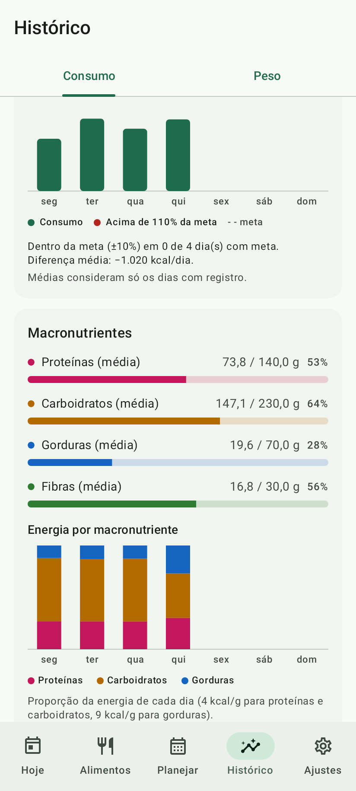 | 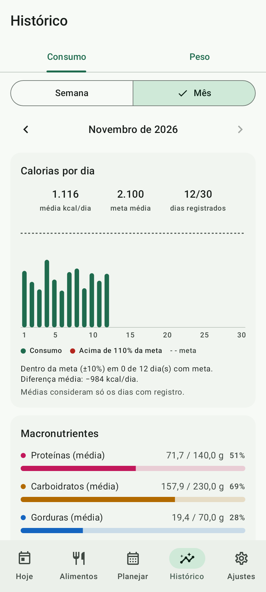 | 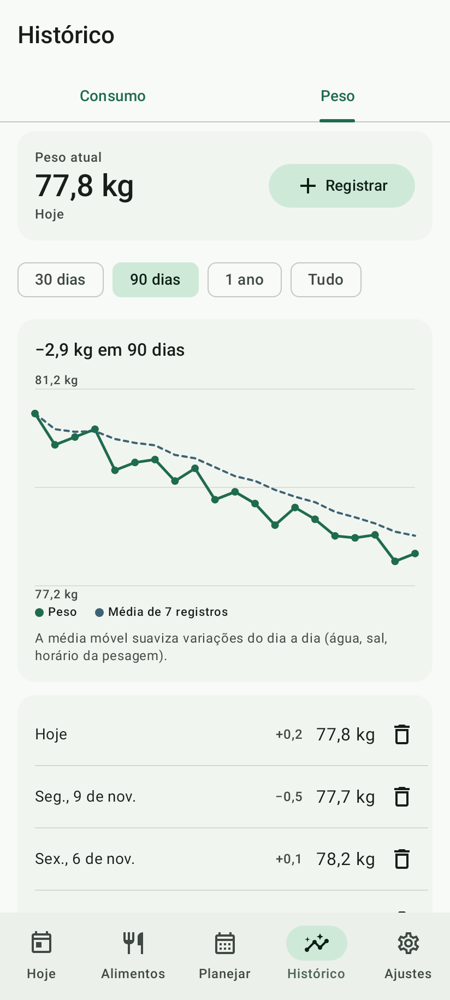 | 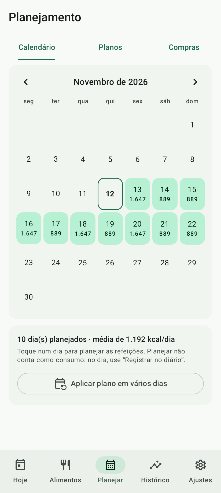 |

| Dia planejado | Planos | Editor de plano | Lista de compras |
|---|---|---|---|
| 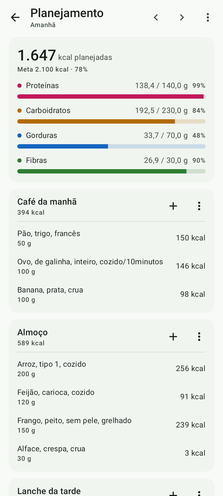 | 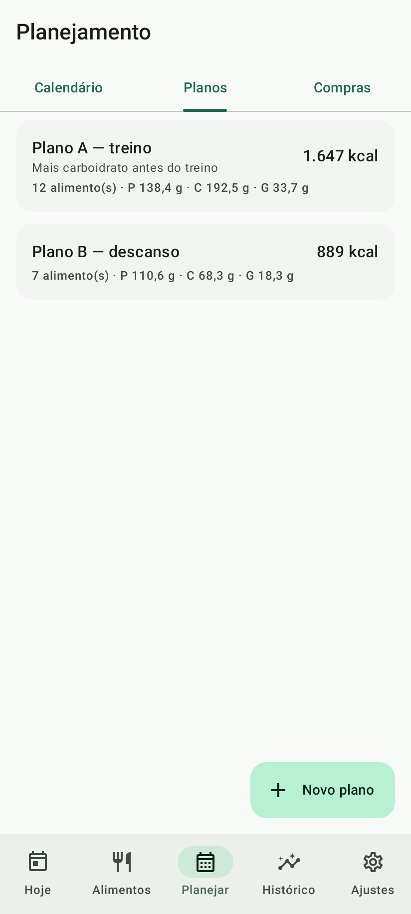 | 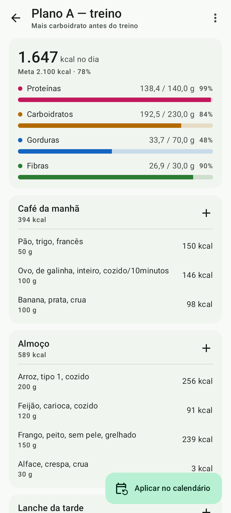 | 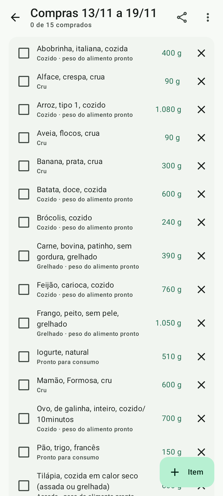 |

| Dados e backup | Calendário (escuro) | Histórico (escuro) | |
|---|---|---|---|
| 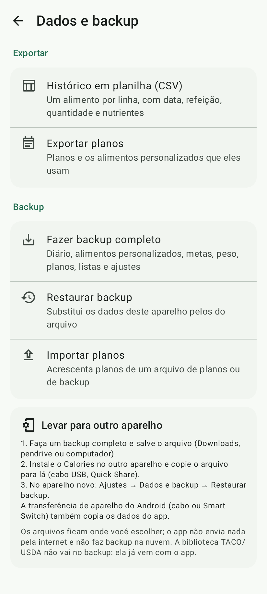 | 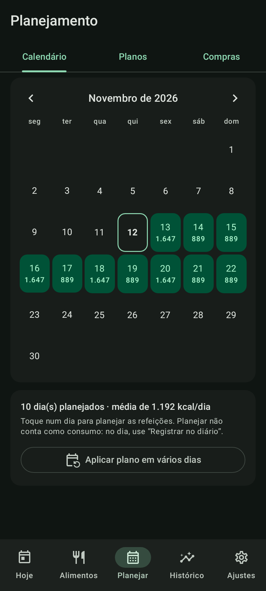 | 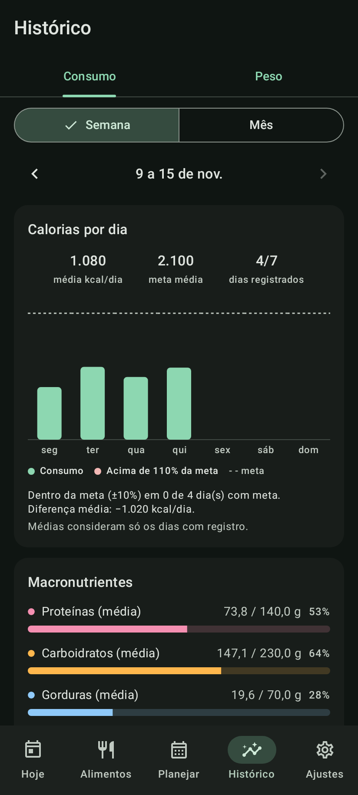 | |

## Instalação no Galaxy S26

1. Copie `release/Calories-0.4.0.apk` para o celular (cabo USB, Google Drive, e-mail para si mesmo…).
2. Abra o arquivo no app **Meus Arquivos**. Na primeira vez, o Android pede para permitir "Instalar apps desconhecidos" para o app usado para abrir: permita.
3. Se o **Auto Blocker** da Samsung estiver ativo (Configurações › Segurança e privacidade › Auto Blocker), desative-o temporariamente para instalar.
4. Na primeira abertura, o app importa a biblioteca de 614 alimentos (cerca de 1 segundo) e cria as cinco refeições padrão.

Atualizações precisam ser assinadas com a **mesma chave**. A chave não fica no repositório (é pública); guarde o arquivo de chave que acompanha a entrega. Sem ela, uma versão nova exige desinstalar a anterior, e isso apaga os dados.

## O que funciona (Fases 3 e 4)

| Área | O que faz |
|---|---|
| **Hoje** | Anel de calorias (consumido, meta, restante, % atingido), barras de proteínas, carboidratos, gorduras e fibras em relação às metas, refeições do dia com seus alimentos e kcal, resumo nutricional completo (inclui gordura saturada e sódio) com aviso de total parcial, navegação por datas. |
| **Refeições** | Adicionar alimentos com quantidade em g (ou ml, para alimentos cadastrados por ml), editar quantidade, mover para outra refeição, remover com "Desfazer", repetir do dia anterior, limpar, salvar como refeição favorita e reaplicá-la. Refeições configuráveis: nome, horário, ordem, ativar e desativar. |
| **Biblioteca** | 614 alimentos: TACO 4ª ed. completa, mais lacunas do USDA marcadas como referência internacional. Busca sem acento, por prefixo e por sinônimos ("aipim", "castanha-do-pará", "carne magra"). Filtros: recentes, favoritos, meus e categoria. |
| **Detalhe do alimento** | Valores por 100 g com "Tr", "NA" e "—" explicados, calculadora de porção, observações da fonte, citação, favoritar. Alimentos da biblioteca são somente leitura: "Duplicar" cria uma versão sua. |
| **Alimentos personalizados** | Nome, marca, categoria, preparo, base do rótulo (ex.: por 30 g ou por 100 ml), energia, proteínas, carboidratos e gorduras obrigatórios; saturada, fibras e sódio opcionais. Validação de plausibilidade (saturada > gordura, macros > 100 %, aviso de energia incoerente). Editar e excluir; se o alimento estiver numa refeição favorita, é arquivado. |
| **Cálculo** | Valor consumido = valor de referência × quantidade ÷ quantidade de referência, sem arredondar; o arredondamento é só na tela (`HALF_UP`, pt-BR). O histórico guarda uma cópia dos valores usados: editar o alimento depois não altera o passado. |
| **Metas** | Calorias, proteínas, carboidratos, gorduras e fibras, vigentes a partir da data em que foram definidas (dias anteriores mantêm a meta antiga). Calculadora opcional (Mifflin-St Jeor, fatores de atividade, objetivo e ajuste), identificada como aproximação e editável. |
| **Histórico** | Semana ou mês, navegando para qualquer período passado: barras de kcal por dia com a linha da meta (vermelho acima de 110 %), média diária, meta média, dias registrados, dias dentro da meta (±10 %), macros médios × metas e distribuição da energia por macronutriente. Lista dos dias; toque abre o dia no diário. Médias só sobre dias com registro. |
| **Peso** | Um registro por dia (com observação), editar, remover com "Desfazer", gráfico com média móvel de 7 registros, janelas de 30/90 dias, 1 ano ou tudo, variação no período. |
| **Planejamento** | Calendário do mês com as kcal planejadas por dia. Dia planejado: adicionar alimentos por refeição, editar quantidades, aplicar um plano, copiar o dia para outra data, registrar no diário (o dia todo ou uma refeição) e limpar. Planejar não conta como consumo até ser registrado; o diário guarda a cópia dos valores no momento do registro. **Hoje** mostra o que está planejado para o dia, com atalho para registrar. |
| **Planos (A/B/C)** | Modelos de dia reutilizáveis: criar do zero ou a partir de um dia do diário, editar, renomear, duplicar, excluir e aplicar num intervalo de datas filtrando dias da semana (ex.: Plano A seg/qua/sex, Plano B nos outros), substituindo ou somando ao que já estava planejado. |
| **Lista de compras** | Gerada do planejamento num período (todas as refeições ou só algumas), somando o mesmo alimento: 150 g + 150 g + 100 g de frango = 400 g. Preparos diferentes não se misturam; alimentos preparados aparecem em peso pronto (as tabelas não trazem fator de rendimento para converter em cru, e ele não é inventado). Marcar comprado, editar quantidade, itens manuais, limpar comprados, compartilhar como texto. |
| **Dados e backup** | Histórico em CSV (padrão ou Excel em português, com `;` e vírgula decimal; todo o período, últimos 30 dias ou o ano), backup completo em JSON, restauração com validação completa e confirmação (arquivo inválido, de versão futura ou com alimento inexistente é recusado sem tocar nos dados), exportar e importar planos, passo a passo para levar a outro aparelho. Usa o seletor de arquivos do sistema: o app não pede permissão de armazenamento. |
| **Privacidade** | Sem permissão de internet (verificado por teste), sem conta, sem anúncios. Backup em nuvem do Android desligado; a transferência direta entre aparelhos (Smart Switch) leva os dados. |
| **Aparência** | Claro, escuro ou sistema; opção de cores do papel de parede (Material You). |

**Próxima fase (5):** revisão final de testes e entrega.

## Documentação

| Documento | Conteúdo |
|---|---|
| [docs/01-arquitetura.md](docs/01-arquitetura.md) | Clean Architecture + MVVM, módulos, camadas, Hilt, decisões técnicas, estrutura de diretórios, bibliotecas e versões, privacidade |
| [docs/02-banco-de-dados.md](docs/02-banco-de-dados.md) | Modelagem Room: tabelas, índices, separação biblioteca / personalizados / histórico / planejamento, snapshots, migrations |
| [docs/03-biblioteca-nutricional.md](docs/03-biblioteca-nutricional.md) | Fontes (TACO, USDA; por que não a TBCA), condições de uso, pipeline de importação, checagem cruzada, validação, curadoria, cobertura |
| [nutrition-data/reports/import-report.md](nutrition-data/reports/import-report.md) | Relatório da última importação (gerado) |
| [docs/04-calculo-nutricional.md](docs/04-calculo-nutricional.md) | Fórmulas, status de nutrientes, agregação, arredondamento, metas, Mifflin-St Jeor, vetores de teste |
| [docs/05-navegacao-e-interface.md](docs/05-navegacao-e-interface.md) | Navegação, telas, fluxos, diretrizes visuais |
| [docs/06-plano-de-entrega.md](docs/06-plano-de-entrega.md) | Fases, testes, entregáveis, riscos |

## Desenvolvimento

Requisitos: JDK 21 e Android SDK (platform 37, build-tools 36.1). O wrapper baixa o Gradle 9.9.0.

APK de debug:

```bash
./gradlew :app:assembleDebug
```

APK de release (precisa de `keystore.properties` na raiz, apontando para a chave):

```bash
./gradlew :app:assembleRelease
```

Testes de todos os módulos (domínio, formato do asset, importador, dados com Robolectric e migration 1→2, app com fluxos de ponta a ponta de diário, planejamento e backup):

```bash
./gradlew test
```

Capturas de tela do app real em `app/build/screenshots/`:

```bash
./gradlew :app:testDebugUnitTest --tests "*ScreenshotTest*" -Pscreenshots
```

Regerar a biblioteca nutricional a partir dos arquivos oficiais em `nutrition-data/raw/`:

```bash
./gradlew :tools:food-importer:generateFoodLibrary
```

Conferir que o asset commitado é exatamente o gerado:

```bash
./gradlew :tools:food-importer:verifyFoodLibrary
```

Pilha: Kotlin 2.4 · Jetpack Compose (BOM 2026.09) · Material 3 · Room 2.8 · Coroutines/Flow · DataStore · Navigation Compose com rotas tipadas · Hilt · AGP 9.5. compileSdk 37, targetSdk 36, minSdk 26.

## Fontes nutricionais

- NEPA/UNICAMP. *Tabela Brasileira de Composição de Alimentos — TACO*. 4. ed. rev. e ampl. Campinas, 2011.
- U.S. Department of Agriculture, Agricultural Research Service. *FoodData Central: SR Legacy (2018-04)*. Domínio público (CC0); usado só para lacunas da TACO.

A TBCA (FoRC/USP) não foi incorporada: o termo de uso proíbe a reprodução do material (ver docs/03, §3.2).

As estimativas do app não substituem orientação de nutricionista ou médico.
