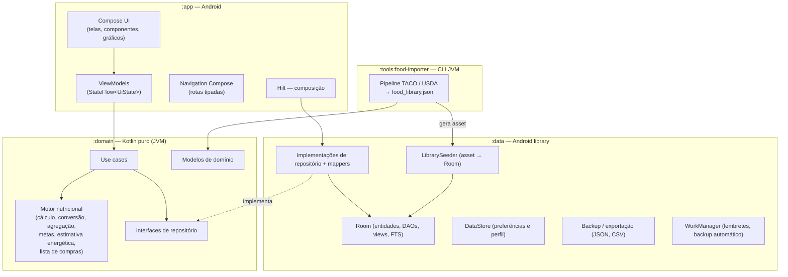
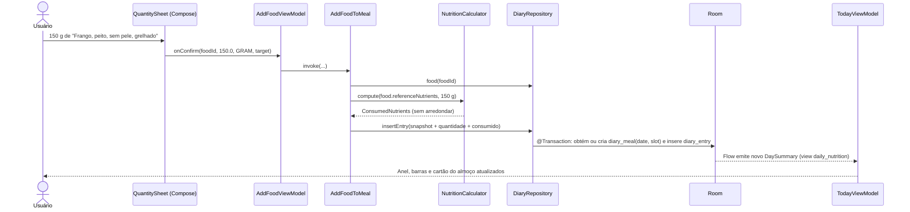

# 1. Arquitetura

> Fase 1: análise e arquitetura. Nenhum código de produção foi escrito ainda.
> Este documento é a referência das fases 2 a 5. Mudanças de rumo devem atualizar este arquivo.

## 1.1 Objetivo

O Calories é um diário alimentar e planejador nutricional pessoal. Ele roda no próprio celular (Galaxy S26), funciona offline e não usa servidor. As restrições abaixo orientam todas as decisões:

| Restrição | Consequência na arquitetura |
|---|---|
| Offline-first, sem backend, sem nuvem | Room é a única fonte de verdade. Não há camada remota nem sincronização. O manifesto **não declara `INTERNET`**. |
| Biblioteca nutricional já instalada | Um pipeline fora do app gera um asset versionado. O app importa esse asset de forma idempotente. |
| Precisão e rastreabilidade dos dados | Cada alimento traz fonte, código original, preparo e o status de cada nutriente (medido, traço, não aplicável, ausente). |
| Histórico imutável | Cada registro de consumo guarda uma cópia (snapshot) dos valores usados. Editar ou apagar um alimento depois não altera o passado. |
| Projeto sem arquivos gigantes, com SOLID | Módulos e pacotes por funcionalidade. Use cases pequenos. Interfaces de repositório no domínio. |

## 1.2 Visão geral

Clean Architecture com MVVM na apresentação. As dependências apontam para dentro, rumo ao domínio.



### Regras de dependência

- `:domain` não conhece Android, Room, Compose nem Hilt. Usa apenas Kotlin, `kotlinx-coroutines-core`, `java.time` e a anotação `javax.inject.Inject` (JSR-330, Java puro), que deixa o Hilt construir os use cases sem acoplar o domínio ao Android.
- `:data` depende de `:domain`. Entidades Room e DAOs são `internal`, então nenhuma tela consegue usar uma entidade diretamente.
- `:app` depende de `:domain`. Depende de `:data` só para a composição no Hilt.
- `:tools:food-importer` depende de `:domain`. Ele reutiliza os modelos e validadores nutricionais, então o importador e o app aplicam as mesmas regras.
- `:library-format` define o formato do asset da biblioteca (`LibraryAsset`). O importador o escreve e o `:data` o lê, então os dois lados nunca divergem.

Essas fronteiras são garantidas pelo compilador, não por convenção. O código de `:domain` simplesmente não compila se importar `android.*`.

## 1.3 Módulos Gradle

| Módulo | Tipo | Responsabilidade |
|---|---|---|
| `:app` | `com.android.application` | Activity única, tema, navegação, telas e ViewModels por funcionalidade, componentes reutilizáveis, gráficos em Canvas, formatação pt-BR. |
| `:domain` | Kotlin/JVM | Modelos (`Food`, `Nutrients`, `Quantity`, `DiaryEntry`…), motor nutricional, use cases, interfaces de repositório, `Clock` injetável. |
| `:data` | `com.android.library` | Room (schema, DAOs, views, FTS, migrations), repositórios, `LibrarySeeder`, DataStore, backup e exportação, workers. |
| `:library-format` | Kotlin/JVM + kotlinx.serialization | Formato do asset `food_library.json` (`LibraryAsset`, `LibraryAssetCodec`), compartilhado entre importador e app. |
| `:tools:food-importer` | Kotlin/JVM (aplicação CLI) | Lê os arquivos oficiais das fontes, faz a checagem cruzada, normaliza, valida e gera `food_library.json` e o relatório de importação. Não entra no APK. |

Não haverá módulos por funcionalidade (`:feature:*`). Para um app pessoal com cinco abas, o custo de build e configuração não compensa. A separação por funcionalidade fica nos pacotes de `:app`.

## 1.4 Camadas e responsabilidades

### Apresentação (`:app`)

- **Telas Compose sem estado.** Cada tela recebe `UiState` e callbacks. O ViewModel é obtido só na função de rota (`XxxRoute`), o que permite pré-visualizar e testar a tela com estados fixos.
- **ViewModel** expõe `StateFlow<UiState>` com `stateIn(viewModelScope, WhileSubscribed(5_000), initial)`. Eventos de uma vez só (snackbar "Desfazer", navegação) usam `Channel` consumido pela rota.
- **Formatação** (`ui/format`): arredondamento de exibição, `Locale("pt","BR")`, vírgula decimal, "Tr", "NA" e "—". O domínio nunca arredonda (ver [04-calculo-nutricional.md](04-calculo-nutricional.md)).
- **Componentes reutilizáveis** (`ui/components`): `CalorieRing`, `MacroBar`, `NutrientRow`, `MealCard`, `FoodListItem`, `QuantityInput`, `DateSwitcher`, `EmptyState`, `SourceBadge`, `PreparationChip`.
- **Gráficos** (`ui/charts`): barras, linha e anel desenhados em Canvas (ver 1.7).

### Domínio (`:domain`)

- **Modelos imutáveis** (`data class` e `value class`), sem anotações de persistência.
- **Motor nutricional** (`domain/nutrition`), com funções puras e determinísticas:
  - `NutritionCalculator`: escala os valores de referência para a quantidade consumida.
  - `UnitConverter`: g ↔ ml ↔ porção, só com densidade ou porção documentada.
  - `NutrientAggregator`: soma refeições e dias e controla quais totais são parciais.
  - `GoalProgressCalculator`: consumido, meta, restante e percentual.
  - `EnergyEstimator`: Mifflin-St Jeor com fator de atividade e ajuste pelo objetivo.
  - `ShoppingListConsolidator`: soma ingredientes de refeições planejadas.
- **Use cases**: uma classe por ação, com `operator fun invoke`. Cada use case valida a entrada, chama repositórios e devolve `AppResult<T>` (sucesso ou erro de domínio tipado). Lista completa na seção 1.6.
- **Interfaces de repositório**: `FoodRepository`, `DiaryRepository`, `GoalRepository`, `PlanningRepository`, `ShoppingRepository`, `WeightRepository`, `BackupRepository`, `SettingsRepository`.

### Dados (`:data`)

- **Room** é a fonte única de verdade. Leituras observáveis retornam `Flow` e escritas são `suspend` em transação. O esquema está em [02-banco-de-dados.md](02-banco-de-dados.md).
- **Repositórios** convertem entidade ↔ domínio (mappers `internal`). Operações compostas usam `withTransaction`, por exemplo "copiar dia" ou "registrar refeição planejada".
- **`LibrarySeeder`** importa o asset da biblioteca quando a versão do asset é maior que a instalada (ver [03-biblioteca-nutricional.md](03-biblioteca-nutricional.md#36-importação-no-app-seed)).
- **DataStore (Preferences)** guarda o tema, o uso de Material You, o perfil da calculadora (idade, sexo, altura, nível de atividade, objetivo) e as opções de exportação. Dados nutricionais nunca vão para o DataStore.
- **Backup e exportação**: JSON com `kotlinx.serialization` e CSV gerado sem biblioteca, pelo Storage Access Framework, sem permissão de armazenamento.
- **WorkManager**, só para tarefas opcionais ativadas pelo usuário: lembrete de refeição e backup automático periódico numa pasta escolhida.

## 1.5 Injeção de dependências (Hilt)

| Módulo Hilt | Fornece |
|---|---|
| `DatabaseModule` (`:data`) | `CaloriesDatabase` (singleton) e um DAO por agregado. |
| `RepositoryModule` (`:data`) | `@Binds` de cada interface do domínio para sua implementação. |
| `DataStoreModule` (`:data`) | `DataStore<Preferences>`. |
| `DispatchersModule` (`:data`) | `@IoDispatcher` e `@DefaultDispatcher`, substituíveis nos testes. |
| `TimeModule` (`:app`) | `Clock` (`java.time`), usado para "hoje" e carimbos de data. Os testes usam relógio fixo. |
| `WorkerModule` (`:app`) | `HiltWorkerFactory` para WorkManager. |

Os use cases não precisam de módulo: têm `@Inject constructor` e o Hilt os constrói.

## 1.6 Use cases planejados

| Área | Use cases |
|---|---|
| Alimentos | `SearchFoods`, `ObserveFood`, `CreateCustomFood`, `UpdateCustomFood`, `DeleteOrArchiveCustomFood`, `DuplicateAsCustomFood`, `ToggleFavoriteFood`, `ObserveRecentFoods` |
| Diário (Hoje) | `ObserveDaySummary(date)`, `AddFoodToMeal`, `UpdateEntryQuantity`, `RemoveEntry` (com desfazer), `MoveEntry`, `CopyMeal`, `CopyDay`, `SaveMealAsTemplate`, `ApplyMealTemplate`, `LogPlannedMeal` |
| Refeições | `ObserveMealSlots`, `SaveMealSlot`, `ReorderMealSlots`, `ObserveMealTemplates`, `SaveMealTemplate`, `DeleteMealTemplate` |
| Metas | `ObserveGoalForDate`, `SetGoal(effectiveFrom)`, `EstimateEnergyNeeds` |
| Histórico | `ObserveDailyTotals(range)`, `ObservePeriodAverages(week/month)`, `ObserveWeightRecords`, `SaveWeightRecord`, `DeleteWeightRecord` |
| Planejamento | `SaveDietPlan`, `DeleteDietPlan`, `DuplicateDietPlan`, `ApplyPlanToDates(planId, datas, REPLACE/APPEND)`, `CopyPlannedDay`, `ObservePlannedDay`, `EditPlannedMeal` |
| Compras | `GenerateShoppingList(seleção)`, `ToggleShoppingItem`, `AddManualShoppingItem`, `EditShoppingItemQuantity`, `DeleteShoppingList` |
| Dados | `ExportDiaryCsv(range)`, `ExportAllJson`, `ExportDietPlans`, `CreateBackup`, `ValidateBackup`, `RestoreBackup` |

## 1.7 Decisões técnicas

| # | Decisão | Alternativas consideradas | Motivo |
|---|---|---|---|
| D1 | Módulos `app`, `domain`, `data`, `library-format` e `tools` | Um único `:app` com pacotes; módulos por funcionalidade | O compilador garante as fronteiras de camada. Os testes de domínio rodam na JVM, em segundos. O importador reaproveita as regras do domínio. |
| D2 | Uma tabela `food` com coluna `origin` (`LIBRARY`/`CUSTOM`) | Duas tabelas, uma para a biblioteca e outra para os personalizados | Uma única chave estrangeira para refeições e planos, e uma única busca. A proteção da biblioteca vem de três camadas: DAOs separados, regra de domínio e teste (ver 02, §2.4). |
| D3 | Snapshot nutricional em cada `diary_entry` | Recalcular o histórico a partir do alimento vivo | O requisito exige preservar os valores do momento do consumo. |
| D4 | `daily_nutrition` como `@DatabaseView` | Tabela de totais atualizada pelo app | Sem cache não há como os totais divergirem dos lançamentos. O volume (alguns milhares de linhas por ano) é trivial para o SQLite com índice por data. |
| D5 | Metas versionadas por `effectiveFrom` | Uma meta global sobrescrita | O histórico compara cada dia com a meta que valia naquele dia. |
| D6 | Planos (modelos) separados de refeições planejadas (calendário) e do diário (consumo) | Uma tabela de refeições com status | Mantém separados planejamento futuro e histórico. Editar um plano não altera dias já planejados nem o histórico. |
| D7 | Biblioteca entregue como asset JSON versionado e importada por *upsert* via `sourceKey` | `RoomDatabase.createFromAsset` | `createFromAsset` só roda na criação do banco e não atualiza a biblioteca em versões futuras sem conflitar com dados do usuário. O *upsert* é idempotente e não duplica alimentos. |
| D8 | Cálculo em `Double` sem arredondar; arredondamento `HALF_UP` só na exibição | `BigDecimal` em todo lugar; inteiros em miligramas | `Double` tem cerca de 15 dígitos significativos, muito além da precisão das tabelas (1 casa decimal). Somar valores não arredondados evita a divergência "soma das partes ≠ total". |
| D9 | Busca com FTS4 (`unicode61`, sem acento) e sinônimos | `LIKE '%termo%'` | Busca por prefixo ("frang grel"), ignora acentos ("feijao"), aceita sinônimos ("aipim", "macaxeira") e continua rápida com dezenas de milhares de alimentos. |
| D10 | Gráficos próprios em Canvas | Vico, MPAndroidChart | Os gráficos necessários são simples (barras com linha de meta, linha de peso, barras empilhadas de macros, anel). Desenhá-los dá controle total do visual discreto e evita uma dependência com histórico de mudanças incompatíveis. |
| D11 | Navigation Compose 2.x com rotas `@Serializable` | Navigation 3 | Foi o que o requisito pediu e é estável. Rotas tipadas eliminam strings de rota e argumentos sem tipo. |
| D12 | Sem permissão `INTERNET`; backup na nuvem do Android desligado | Padrão do template | Privacidade verificável: o app não tem como transmitir dados. A transferência entre aparelhos continua pelo backup em arquivo e pela transferência direta (`device-transfer`, usada pelo Smart Switch). |
| D13 | Datas do diário como `LocalDate` (`epochDay`) | Timestamp UTC | Uma refeição pertence ao dia local em que foi consumida. Viajar ou mudar de fuso não move registros entre dias. |

## 1.8 Fluxo de dados (exemplo: adicionar alimento ao almoço)



O dashboard não é atualizado por chamada direta. Ele observa o `Flow` do Room, e qualquer escrita em `diary_entry` provoca nova emissão. Assim o requisito "atualizar automaticamente ao adicionar, editar ou remover" vale em qualquer caminho, inclusive desfazer, restaurar backup e registrar refeição planejada.

## 1.9 Estrutura de diretórios

```
calories-apk/
├── README.md
├── settings.gradle.kts
├── build.gradle.kts
├── gradle/libs.versions.toml            # catálogo único de versões
├── docs/                                # esta documentação
├── nutrition-data/                      # dados de origem versionados (ver 03)
│   ├── README.md
│   ├── sources.lock.json                # URL, data de acesso e SHA-256 de cada arquivo bruto
│   ├── raw/                             # arquivos oficiais, sem modificação
│   │   ├── taco-4ed/                    # planilha .xlsx + PDF do NEPA/UNICAMP
│   │   └── usda-fdc/                    # CSV SR Legacy 2018-04
│   ├── curation/                        # decisões humanas, revisáveis em PR (ver 03, §3.5)
│   └── reports/import-report.md         # relatório gerado a cada importação
├── library-format/                      # formato do asset (LibraryAsset, LibraryAssetCodec)
├── tools/
│   └── food-importer/
│       └── src/main/kotlin/com/calories/importer/
│           ├── Main.kt, ImportPipeline.kt, SourcesLock.kt
│           ├── io/        (CsvReader, XlsxReader, Hashing)
│           ├── taco/      (TacoWorkbook, TacoValue, TacoNormalizer, TacoPdfCrossCheck)
│           ├── usda/      (FdcSrLegacyReader)
│           ├── curation/  (Curation)
│           ├── classify/  (PreparationClassifier)
│           ├── assemble/  (FoodAssembler)
│           ├── validate/  (LibraryValidator)
│           └── report/    (ImportReport)
├── domain/
│   └── src/main/kotlin/com/calories/domain/
│       ├── model/        (Food, Nutrients, NutrientValue, Quantity, MeasureUnit, Preparation,
│       │                  DiaryEntry, DaySummary, NutritionGoal, DietPlan, PlannedMeal, ShoppingList…)
│       ├── nutrition/    (NutritionCalculator, UnitConverter, NutrientAggregator,
│       │                  GoalProgressCalculator, EnergyEstimator, ShoppingListConsolidator)
│       ├── repository/   (interfaces)
│       ├── usecase/      (food/, diary/, goal/, history/, planning/, shopping/, data/)
│       └── common/       (AppResult, DomainError, Clock)
├── data/
│   ├── schemas/                         # esquemas Room exportados (JSON), versionados
│   └── src/main/kotlin/com/calories/data/
│       ├── db/
│       │   ├── CaloriesDatabase.kt
│       │   ├── entity/   (um arquivo por entidade)
│       │   ├── dao/      (FoodQueryDao, CustomFoodDao, LibrarySeedDao, DiaryDao, PlanningDao…)
│       │   ├── view/     (DailyNutritionView)
│       │   ├── converter/ (LocalDate, enums)
│       │   └── migration/ (Migrations.kt, AutoMigrationSpecs)
│       ├── repository/   (implementações + mappers)
│       ├── seed/         (LibrarySeeder, DefaultsSeeder; lê o asset via :library-format)
│       ├── backup/       (BackupDto, BackupValidator, BackupManager, CsvWriter)
│       ├── preferences/  (SettingsDataStore)
│       └── work/         (MealReminderWorker, AutoBackupWorker)
└── app/
    └── src/main/
        ├── assets/library/food_library.json   # gerado pelo importador (não editar à mão)
        └── kotlin/com/calories/
            ├── CaloriesApplication.kt
            ├── MainActivity.kt
            ├── navigation/   (Routes.kt, CaloriesNavHost.kt, BottomBar.kt)
            ├── ui/
            │   ├── theme/    (Color, Type, Shape, Theme)
            │   ├── components/
            │   ├── charts/
            │   └── format/   (NutritionFormatter, DateFormatter)
            └── feature/
                ├── today/        (TodayRoute, TodayScreen, TodayViewModel, components/)
                ├── foodpicker/   (busca + seleção, compartilhado entre diário, plano e modelo)
                ├── foods/        (lista, detalhe, editor)
                ├── meals/        (modelos de refeição)
                ├── planning/     (calendário, dia planejado, planos, aplicar plano)
                ├── shopping/
                ├── history/      (dia, semana, mês, detalhe do dia)
                ├── weight/
                └── settings/     (metas, calculadora, refeições, aparência, dados, fontes, sobre)
```

Convenções:
- Um arquivo por tela, ViewModel ou entidade. Arquivo com mais de cerca de 300 linhas é sinal para dividir.
- Pacote base: `com.calories`. `applicationId`: `com.calories`.
- Strings de interface em `res/values/strings.xml`, em pt-BR.

## 1.10 Bibliotecas

Versões fixadas em `gradle/libs.versions.toml` e compilando desde a Fase 3. O plano B (AGP 8.13) não foi necessário.

| Biblioteca | Versão | Uso |
|---|---|---|
| Android Gradle Plugin | 9.5.1 (Kotlin embutido) | Build |
| Gradle (wrapper) | 9.9.0 | Build |
| Kotlin | 2.4.21 | Linguagem, plugins Compose e serialization |
| KSP | 2.3.13 | Room e Hilt |
| JDK (toolchain) | 21 | Compilação |
| Compose BOM | 2026.09.00 (Material 3 1.4.0, UI 1.12.1) | UI, ícones, animações |
| Navigation Compose | 2.10.2 | Rotas tipadas (`@Serializable`) |
| Lifecycle | 2.11.0 | `collectAsStateWithLifecycle`, ViewModel |
| Activity Compose / Core KTX | 1.13.0 / 1.19.1 | Activity, edge-to-edge |
| Hilt / AndroidX Hilt | 2.60.1 / 1.4.0 | Injeção de dependências, `hiltViewModel()` |
| Room (+ plugin `androidx.room`) | 2.8.5 | Banco, esquemas exportados em `data/schemas` |
| DataStore Preferences | 1.3.0 | Preferências e perfil da calculadora |
| kotlinx-coroutines | 1.11.0 | Concorrência e Flow |
| kotlinx-serialization-json | 1.12.0 | Asset da biblioteca, rotas |
| JUnit 4, Robolectric 4.17, AndroidX Test 1.7, Compose UI Test, Turbine 1.2.1 | — | Testes JVM, Room e fluxo de UI |
| Apache PDFBox | 3.0.8 | Só no importador; não vai para o APK |
| WorkManager | 2.12.0 (Fase 4) | Lembretes e backup automático; ainda não usado |

SDK:
- `compileSdk 37`: as bibliotecas atuais (ex.: core-ktx 1.19) exigem.
- `targetSdk 36` (Android 16, o do Galaxy S26).
- `minSdk 26`.

Release:
- R8 com remoção de código e recursos não usados, **sem ofuscação** (`-dontobfuscate`). O app é de código aberto, e nomes preservados evitam falhas por reflexão.
- APK de 2,1 MB.

Ficam de fora:
- Firebase, analytics e crash reporting remoto.
- Retrofit, OkHttp e qualquer biblioteca de rede.
- Bibliotecas de gráfico (ver D10).
- Bibliotecas de CSV: o escritor RFC 4180 tem cerca de 40 linhas e é testado.

## 1.11 Privacidade e permissões

| Item | Configuração |
|---|---|
| `INTERNET` | Não declarada. Um teste de build falha se ela aparecer no manifesto final mesclado. |
| `POST_NOTIFICATIONS` | Pedida só quando o usuário ativa lembretes de refeição. |
| Armazenamento | Nenhuma permissão. Importação e exportação usam o seletor de arquivos do sistema (SAF). |
| Backup automático do Android | `dataExtractionRules`: `cloud-backup` exclui tudo e `device-transfer` inclui o banco, para que o Smart Switch transfira os dados localmente. |
| Conta, login, publicidade | Nenhum. |
| Logs | Sem log de dados nutricionais em release. R8 remove `Log.d`/`Log.v`. |

## 1.12 Desempenho

- Todas as consultas observáveis são `Flow` do Room com `distinctUntilChanged()`. Nada é consultado na thread principal.
- Há índice em toda coluna de chave estrangeira e em toda coluna de data. As agregações (`daily_nutrition`) rodam no SQLite.
- A importação da biblioteca usa uma transação única com inserção em lote. Para alguns milhares de alimentos, a meta é menos de 1 s num aparelho topo de linha. A tela inicial mostra "Preparando biblioteca…" enquanto `LibraryState = Seeding`.
- Listas com `LazyColumn` e `key` estável. Nenhuma lista longa usa `Column` com `verticalScroll`.
- Perfil de inicialização (Baseline Profile) é opcional e só entra na Fase 5 se a medição mostrar necessidade.
