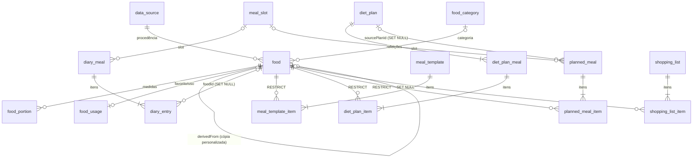

# 2. Banco de dados (Room)

> **Esquema v1 implementado na Fase 3** (`data/schemas/com.calories.data.db.CaloriesDatabase/1.json`).
>
> **Tabelas e view:** `data_source`, `food_category`, `food` + `food_fts`, `food_usage`, `meal_slot`, `diary_meal`, `diary_entry`, `nutrition_goal`, `meal_template`, `meal_template_item`, `app_meta` e a view `daily_nutrition`.
>
> **Ficam para a Fase 4, via migration 1 → 2 testada:** `food_portion`, `weight_record`, `diet_plan*`, `planned_meal*` e `shopping_list*`.
>
> **Diferenças em relação ao desenho abaixo:**
> - No v1, a quantidade do lançamento já está na unidade de referência do alimento (sem porções). O snapshot fica em `refAmount` + colunas `ref_*`, e o consumo em colunas sem prefixo.
> - A fonte dos personalizados é `USER`.

## 2.1 Princípios

1. **Quatro domínios de dados separados**: biblioteca, personalizados, histórico e planejamento (tabela em 2.4).
2. **O histórico nunca depende do cadastro vivo.** Cada lançamento no diário carrega uma cópia dos valores de referência e os valores consumidos já calculados.
3. **Ausência de dado é `NULL`**, nunca zero inventado. "Traço" e "não aplicável" são marcados explicitamente (ver [04-calculo-nutricional.md](04-calculo-nutricional.md#42-status-de-cada-nutriente)).
4. **Datas do diário são `LocalDate`**, guardadas como `epochDay` (INTEGER). Instantes técnicos (`createdAt`, `updatedAt`) são epoch em milissegundos.
5. **Quantidades em `REAL`** (`Double`), sem arredondar. Toda coluna de quantidade ou nutriente tem sufixo de unidade (`proteinG`, `sodiumMg`, `energyKcal`).
6. **Toda chave estrangeira tem índice** e uma política `onDelete` explícita.

## 2.2 Mapeamento das entidades sugeridas

| Sugestão do requisito | Tabela(s) no projeto | Observação |
|---|---|---|
| Food | `food`, `food_fts`, `food_portion`, `food_usage`, `data_source` | Valores, busca, medidas caseiras, estado do usuário e procedência ficam em tabelas separadas. |
| FoodCategory | `food_category` | Categorias do app. O grupo original da fonte fica em `food.sourceGroup`. |
| Meal | `meal_slot` + `diary_meal` | `meal_slot` é a configuração ("Almoço, 12:00"). `diary_meal` é a refeição de um dia específico. |
| MealFood | `diary_entry` | Item consumido, com snapshot nutricional. |
| DailyNutrition | `daily_nutrition` (**view**) | Calculada a partir do diário. Não é cache (decisão D4). |
| NutritionGoal | `nutrition_goal` | Versionada por `effectiveFrom`. |
| WeightRecord | `weight_record` | Um registro por dia. |
| DietPlan | `diet_plan`, `diet_plan_meal`, `diet_plan_item` | Modelo reutilizável ("Plano A — Dias de treino"). |
| PlannedMeal | `planned_meal`, `planned_meal_item` | Instância no calendário (data). |
| ShoppingList / ShoppingListItem | `shopping_list`, `shopping_list_item` | — |
| — | `meal_template`, `meal_template_item` | Refeições favoritas reutilizáveis. |
| — | `app_meta` | Versão da biblioteca instalada e controle do seed. |

## 2.3 Diagrama entidade-relacionamento



`nutrition_goal`, `weight_record`, `app_meta` e a view `daily_nutrition` não têm chaves estrangeiras.

## 2.4 Separação dos domínios de dados

| Domínio | Tabelas | Quem escreve | Garantias |
|---|---|---|---|
| **Biblioteca original** | `food` (`origin = 'LIBRARY'`), `data_source`, `food_portion` (`isUserDefined = 0`), `food_category` (`isSystem = 1`) | Só o `LibrarySeeder`, pelo `LibrarySeedDao` | Nenhum DAO usado pela interface tem `UPDATE` ou `DELETE` sobre linhas `LIBRARY`. Editar um alimento da biblioteca significa **duplicar como personalizado** (`derivedFromFoodId`). |
| **Personalizados** | `food` (`origin = 'CUSTOM'`), `food_portion` (`isUserDefined = 1`) | Usuário, pelo `CustomFoodDao` | Todo `UPDATE` e `DELETE` do `CustomFoodDao` tem `WHERE origin = 'CUSTOM'` na própria query. Mesmo um id errado não altera a biblioteca. |
| **Estado do usuário sobre alimentos** | `food_usage` (favorito, contagem de uso, último uso) | Usuário | Fica fora de `food`, então atualizar a biblioteca nunca apaga favoritos. |
| **Histórico** | `diary_meal`, `diary_entry`, `nutrition_goal`, `weight_record` | Usuário | Snapshot em `diary_entry`. `foodId` com `SET NULL`. Metas versionadas. |
| **Planejamento** | `meal_template*`, `diet_plan*`, `planned_meal*`, `shopping_list*` | Usuário | Referências vivas a `food`. Ao registrar uma refeição planejada como consumida, gera-se um `diary_entry` com snapshot. |

Proteção da biblioteca, em três camadas:
1. **Interface:** a tela de detalhe de um alimento `LIBRARY` não tem botão "Editar", só "Duplicar como personalizado".
2. **Domínio:** `UpdateCustomFood` recusa `origin != CUSTOM` com `DomainError.LibraryFoodIsReadOnly`.
3. **SQL:** as queries do `CustomFoodDao` filtram por `origin = 'CUSTOM'`. Um teste de DAO confirma que um `UPDATE` com id de alimento da biblioteca afeta 0 linhas.

## 2.5 Tabelas

Convenção: `PK` chave primária, `FK` chave estrangeira, `UQ` único, `IX` índice, `?` anulável.

### `data_source`: procedência dos dados

| Coluna | Tipo | Notas |
|---|---|---|
| id | INTEGER PK | |
| code | TEXT UQ | `TACO4`, `USDA_SR` (biblioteca); `USER` para personalizados. Novas fontes ganham um código novo. |
| name | TEXT | Nome completo |
| edition | TEXT? | Por exemplo, "4ª edição revisada e ampliada" ou "SR Legacy, abril de 2018" |
| publisher | TEXT? | NEPA/UNICAMP, USDA ARS |
| year | INTEGER? | |
| url | TEXT? | Só referência; o app nunca acessa a URL |
| license | TEXT | Texto curto da licença ou permissão |
| citation | TEXT | Citação recomendada, exibida em "Fontes e licenças" |
| carbohydrateBasis | TEXT | `TOTAL_BY_DIFFERENCE` ou `AVAILABLE` (ver 04, §4.3) |
| accessedAt | TEXT? | Data de acesso aos arquivos (ISO-8601) |

### `food_category`

| Coluna | Tipo | Notas |
|---|---|---|
| id | INTEGER PK | |
| code | TEXT UQ | `PROTEINS`, `CARBS`, `FATS`, `VEGETABLES`, `OTHERS` ou `USER_<uuid>` |
| name | TEXT | Proteínas, Carboidratos, Gorduras, Vegetais e legumes, Outros |
| sortOrder | INTEGER | |
| isSystem | INTEGER (bool) | Categorias de sistema podem ser renomeadas, mas não apagadas |

### `food`: alimento (biblioteca ou personalizado)

| Coluna | Tipo | Notas |
|---|---|---|
| id | INTEGER PK | Autoincremento |
| origin | TEXT IX | `LIBRARY` ou `CUSTOM` |
| sourceKey | TEXT? UQ | Chave estável da biblioteca, igual à `key` do asset: `TACO4:<nº do item>` ou `USDA_SR:<fdcId>`. `NULL` para personalizados. |
| dataSourceId | INTEGER FK → data_source (RESTRICT) IX | |
| sourceCode | TEXT? | Código original na fonte |
| sourceDescription | TEXT? | Descrição original, sem alteração |
| sourceGroup | TEXT? | Grupo original (ex.: "Carnes e derivados") |
| name | TEXT | Nome exibido |
| baseName | TEXT? IX | Nome sem o termo de preparo (ex.: "Frango, peito, sem pele"). Agrupa as variações Cru · Cozido · Grelhado na busca. |
| brand | TEXT? | Marca (personalizados) |
| aliases | TEXT? | Sinônimos separados por `|`, indexados no FTS |
| categoryId | INTEGER? FK → food_category (SET NULL) IX | |
| preparation | TEXT | Enum `Preparation` (ver 03, §3.5) |
| referenceAmount | REAL | Normalmente 100. Para personalizados, o que o rótulo usa (ex.: 30). |
| referenceUnit | TEXT | `GRAM` ou `MILLILITER` |
| densityGPerMl | REAL? | Só com fonte documentada. Habilita g ↔ ml. |
| densitySource | TEXT? | Procedência da densidade |
| energyKcal | REAL? | Por `referenceAmount` |
| proteinG | REAL? | |
| carbohydrateG | REAL? | Base indicada por `data_source.carbohydrateBasis` |
| fatG | REAL? | Lipídios totais |
| saturatedFatG | REAL? | |
| fiberG | REAL? | Fibra alimentar |
| sodiumMg | REAL? | |
| traceMask | INTEGER | Bitset: nutrientes informados como "Tr" (valor gravado = 0) |
| notApplicableMask | INTEGER | Bitset: nutrientes "NA" (valor gravado = 0) |
| derivedFromFoodId | INTEGER? FK → food (SET NULL) IX | Personalizado criado a partir de um item da biblioteca |
| libraryVersion | INTEGER? | Versão do asset que gravou a linha por último |
| isDeprecated | INTEGER (bool) | Removido da biblioteca numa versão nova: fica oculto na busca, mas continua resolvível |
| isArchived | INTEGER (bool) | Personalizado "excluído" que ainda é referenciado por um modelo ou plano |
| notes | TEXT? | |
| createdAt, updatedAt | INTEGER | Epoch em ms |

Índices: `UQ(sourceKey)`, `IX(origin, isArchived, isDeprecated)`, `IX(baseName)`, `IX(categoryId)`, `IX(dataSourceId)`, `IX(derivedFromFoodId)`.

Restrições de domínio, validadas no use case e no importador:
- `referenceAmount > 0`.
- Nutrientes `≥ 0`, quando presentes.
- `saturatedFatG ≤ fatG`.
- Personalizado exige `energyKcal`, `proteinG`, `carbohydrateG` e `fatG`. Fibra, gordura saturada e sódio são opcionais.

### `food_fts`: busca textual (FTS4, tabela de conteúdo externo)

`@Fts4(contentEntity = FoodEntity::class, tokenizer = "unicode61", tokenizerArgs = ["remove_diacritics=1"])` sobre `name`, `brand`, `aliases` e `sourceDescription`. O Room gera os *triggers* que mantêm o índice sincronizado. A consulta usa prefixo por termo (`frang* grel*`). O resultado é ordenado em Kotlin assim:
1. Favorito.
2. Usado recentemente.
3. Nome começa com o termo.
4. Biblioteca brasileira antes da internacional.
5. Ordem alfabética.

### `food_portion`: medidas caseiras (opcional por alimento)

| Coluna | Tipo | Notas |
|---|---|---|
| id | INTEGER PK | |
| foodId | INTEGER FK → food (CASCADE) IX | |
| label | TEXT | "1 unidade média", "1 colher de sopa" |
| amountInReferenceUnit | REAL | Gramas (ou ml) equivalentes |
| source | TEXT? | Procedência (ex.: tabela de medidas referidas do IBGE). Obrigatória para porções da biblioteca. |
| isUserDefined | INTEGER (bool) | |

Medidas da biblioteca só entram com fonte documentada. Sem fonte, o alimento oferece apenas g ou ml. O usuário pode criar suas próprias porções, como "minha concha = 140 g".

### `food_usage`: estado do usuário

| Coluna | Tipo | Notas |
|---|---|---|
| foodId | INTEGER PK, FK → food (CASCADE) | |
| isFavorite | INTEGER (bool) IX | |
| useCount | INTEGER | |
| lastUsedAt | INTEGER? IX | |
| lastAmount | REAL?, lastUnit TEXT? | Pré-preenche a última quantidade usada |

### `meal_slot`: configuração das refeições do dia

| Coluna | Tipo | Notas |
|---|---|---|
| id | INTEGER PK | |
| name | TEXT | Valores iniciais: Café da manhã (07:00), Almoço (12:00), Lanche da tarde (16:00), Jantar (19:30), Ceia (22:00). Todos editáveis. |
| defaultTimeMinutes | INTEGER? | Minutos desde 00:00 |
| sortOrder | INTEGER | |
| isActive | INTEGER (bool) | Desativar esconde o slot nos dias novos sem afetar o histórico |
| reminderEnabled | INTEGER (bool) | Lembrete opcional (WorkManager) |

### `diary_meal`: refeição de um dia (histórico)

| Coluna | Tipo | Notas |
|---|---|---|
| id | INTEGER PK | |
| date | INTEGER IX | `LocalDate.toEpochDay()` |
| slotId | INTEGER? FK → meal_slot (SET NULL) IX | |
| name | TEXT | Cópia do nome do slot no dia (renomear o slot não altera o passado) |
| timeMinutes | INTEGER? | |
| sortOrder | INTEGER | |
| note | TEXT? | |

Índice composto `IX(date, sortOrder)`. O repositório garante no máximo um `diary_meal` por `(date, slotId)` quando `slotId` não é nulo, e cria a refeição sob demanda no primeiro alimento.

### `diary_entry`: alimento consumido (snapshot)

| Coluna | Tipo | Notas |
|---|---|---|
| id | INTEGER PK | |
| diaryMealId | INTEGER FK → diary_meal (CASCADE) IX | |
| foodId | INTEGER? FK → food (SET NULL) IX | Link ao cadastro vivo (para "ver alimento" e "usar de novo") |
| foodSourceKey | TEXT? | Permite religar ao restaurar backup |
| foodName | TEXT | **Snapshot** |
| brand | TEXT? | **Snapshot** |
| preparation | TEXT | **Snapshot** |
| dataSourceCode | TEXT | **Snapshot** (`TACO4`, `USDA_SR`, `USER`) |
| inputAmount | REAL | O que o usuário digitou |
| inputUnit | TEXT | `GRAM`, `MILLILITER` ou `PORTION` |
| portionLabel | TEXT? | Se `inputUnit = PORTION` |
| amountInRefUnit | REAL | Quantidade normalizada usada na fórmula |
| refAmount | REAL | **Snapshot** de `referenceAmount` |
| refUnit | TEXT | **Snapshot** |
| refEnergyKcal … refSodiumMg | REAL? (7 colunas) | **Snapshot** dos valores de referência |
| refTraceMask, refNotApplicableMask | INTEGER | **Snapshot** |
| energyKcal, proteinG, carbohydrateG, fatG, saturatedFatG, fiberG, sodiumMg | REAL? | **Consumido**, calculado pelo `NutritionCalculator` na gravação |
| sortOrder | INTEGER | |
| createdAt, updatedAt | INTEGER | |

Invariante (testada): `consumido = ref × amountInRefUnit / refAmount` para cada nutriente presente. Ao editar a quantidade, o recálculo usa o **snapshot** (`ref*`), nunca o alimento atual.

### View `daily_nutrition`

```sql
CREATE VIEW daily_nutrition AS
SELECT m.date                                   AS date,
       COUNT(e.id)                              AS entryCount,
       SUM(e.energyKcal)                        AS energyKcal,
       SUM(e.proteinG)                          AS proteinG,
       SUM(e.carbohydrateG)                     AS carbohydrateG,
       SUM(e.fatG)                              AS fatG,
       SUM(e.saturatedFatG)                     AS saturatedFatG,
       SUM(e.fiberG)                            AS fiberG,
       SUM(e.sodiumMg)                          AS sodiumMg,
       SUM(CASE WHEN e.energyKcal    IS NULL THEN 1 ELSE 0 END) AS energyMissing,
       SUM(CASE WHEN e.fiberG        IS NULL THEN 1 ELSE 0 END) AS fiberMissing,
       SUM(CASE WHEN e.saturatedFatG IS NULL THEN 1 ELSE 0 END) AS saturatedFatMissing,
       SUM(CASE WHEN e.sodiumMg      IS NULL THEN 1 ELSE 0 END) AS sodiumMissing
FROM diary_meal m
JOIN diary_entry e ON e.diaryMealId = m.id
GROUP BY m.date;
```

As colunas `*Missing` permitem exibir "12,4 g (parcial: 1 alimento sem dado)" sem tratar a ausência como zero. Proteína, carboidrato e gordura também têm contagem de ausentes. Para personalizados esses campos são obrigatórios, mas um item da biblioteca pode ter lacuna.

### `nutrition_goal`: metas versionadas

| Coluna | Tipo | Notas |
|---|---|---|
| id | INTEGER PK | |
| effectiveFrom | INTEGER UQ | `epochDay`. A meta de um dia D é a de maior `effectiveFrom ≤ D`. |
| energyKcal | REAL | |
| proteinG, carbohydrateG, fatG, fiberG | REAL? | Metas opcionais por nutriente |
| origin | TEXT | `MANUAL` ou `ESTIMATED` (calculadora, depois editável) |
| createdAt | INTEGER | |

Alterar a meta hoje grava uma linha com `effectiveFrom = hoje`, substituindo a do mesmo dia se existir. Os dias anteriores continuam comparados com a meta que valia neles.

### `weight_record`

| Coluna | Tipo | Notas |
|---|---|---|
| id | INTEGER PK | |
| date | INTEGER UQ | Um registro por dia; registrar de novo no mesmo dia substitui |
| weightKg | REAL | Validação: 20–400 |
| note | TEXT? | |
| createdAt | INTEGER | |

### `meal_template` e `meal_template_item`: refeições favoritas

`meal_template(id, name, isFavorite, sortOrder, createdAt, updatedAt)`
`meal_template_item(id, templateId FK CASCADE IX, foodId FK RESTRICT IX, inputAmount, inputUnit, portionLabel?, amountInRefUnit, sortOrder)`

### `diet_plan`, `diet_plan_meal`, `diet_plan_item`: modelos de dia

`diet_plan(id, name, description?, colorArgb?, sortOrder, createdAt, updatedAt)`. Exemplos: "Plano A — Dias de treino", "Plano B — Descanso".
`diet_plan_meal(id, planId FK CASCADE IX, slotId FK SET NULL IX?, name, timeMinutes?, sortOrder)`
`diet_plan_item(id, planMealId FK CASCADE IX, foodId FK RESTRICT IX, inputAmount, inputUnit, portionLabel?, amountInRefUnit, sortOrder)`

### `planned_meal` e `planned_meal_item`: calendário

`planned_meal(id, date IX, slotId FK SET NULL IX?, name, timeMinutes?, sourcePlanId FK → diet_plan SET NULL IX?, loggedDiaryMealId?, sortOrder)`
`planned_meal_item(id, plannedMealId FK CASCADE IX, foodId FK RESTRICT IX, inputAmount, inputUnit, portionLabel?, amountInRefUnit, sortOrder)`

Aplicar um plano a uma data **copia** as refeições e os itens do plano para `planned_meal*`, com `sourcePlanId` para rastrear a origem. Editar o plano depois não altera dias já planejados. Editar um dia não altera o plano. O modo `REPLACE` apaga antes as refeições planejadas daquela data; o modo `APPEND` acrescenta.

### `shopping_list` e `shopping_list_item`

`shopping_list(id, name, fromDate?, toDate?, createdAt)`
`shopping_list_item(id, listId FK CASCADE IX, foodId FK SET NULL IX?, name, preparation?, quantity REAL?, unit TEXT?, isChecked, isManual, sortOrder)`

### `app_meta`

`app_meta(key TEXT PK, value TEXT)`. Chaves: `library.version`, `library.sha256`, `library.seededAt`, `defaults.seeded`.

A versão da biblioteca fica **dentro do banco**, e não no DataStore, para mudar na **mesma transação** do *upsert*. Se o app for fechado no meio da importação, nada é gravado e a importação recomeça na próxima abertura.

## 2.6 Políticas de exclusão

| Ação do usuário | Efeito |
|---|---|
| Excluir alimento personalizado **não** referenciado por modelo ou plano | `DELETE`. No diário, `foodId` vira `NULL` e o snapshot permanece. |
| Excluir alimento personalizado referenciado por modelo ou plano | `isArchived = 1`: some da busca e os modelos continuam funcionando. A tela informa onde o alimento é usado e oferece removê-lo desses lugares. |
| Alimento removido da biblioteca numa versão nova do app | `isDeprecated = 1`: some da busca e as referências continuam válidas. |
| Excluir item ou refeição do diário | `DELETE` com snackbar "Desfazer" (reinsere a mesma linha). |
| Excluir plano | `CASCADE` nas refeições e itens do plano. Dias já planejados ficam com `sourcePlanId = NULL`. |
| Excluir slot de refeição | O slot é desativado (`isActive = 0`), não apagado, quando tem histórico. |

## 2.7 Migrations

- `exportSchema = true` e `room.schemaLocation = data/schemas`. Cada versão do esquema é commitada.
- Mudanças aditivas (coluna ou tabela nova) usam `@AutoMigration`.
- Renomeações ou divisões usam `AutoMigrationSpec`. Transformações de dados usam `Migration` manual com SQL explícito.
- `fallbackToDestructiveMigration` **nunca** é usado em release.
- Cada par de versões tem teste com `MigrationTestHelper`: cria o banco na versão N com dados, migra para N+1, valida o esquema e confere os dados (lançamentos, snapshots e metas preservados).
- A versão do esquema e a versão da biblioteca são **independentes**. Atualizar alimentos não exige migration, e uma migration não reimporta alimentos.

## 2.8 Dados iniciais (além da biblioteca)

O `DefaultsSeeder` roda uma vez (`app_meta['defaults.seeded']`) e cria:
- 5 categorias de sistema: Proteínas, Carboidratos, Gorduras, Vegetais e legumes, Outros.
- 5 slots de refeição, com os horários da seção 2.5.
- Nenhuma meta. Na primeira abertura, o dashboard convida a definir a meta, manualmente ou pela calculadora. Sem meta, mostra só o consumido.

## 2.9 Backup e exportação (formato)

| Saída | Conteúdo |
|---|---|
| Backup JSON (`calories-backup-AAAAMMDD.json`) | `formatVersion`, `schemaVersion`, `libraryVersion`, `exportedAt` e todas as tabelas do usuário: personalizados, porções do usuário, `food_usage`, slots, diário completo com snapshots, metas, peso, modelos, planos, calendário e listas. **Não inclui** os alimentos da biblioteca. Eles vêm do asset e são referenciados por `sourceKey`. |
| Restauração | Primeiro valida o arquivo inteiro: formato, versão, enums, faixas numéricas e referências que resolvem (cada `sourceKey` existe na biblioteca instalada ou o item tem snapshot). Depois aplica tudo numa transação: tudo ou nada. Modo único na v1: **substituir** os dados do usuário. |
| CSV do diário | Uma linha por `diary_entry`: data, refeição, alimento, preparo, fonte, quantidade, unidade e nutrientes consumidos sem arredondar. Codificação UTF-8 com BOM, RFC 4180. Duas variantes: padrão (`,` e ponto decimal) e "Excel pt-BR" (`;` e vírgula decimal). |
| Exportação de planos | JSON só com `diet_plan*` e os alimentos personalizados que eles referenciam, para importar em outro aparelho. |
