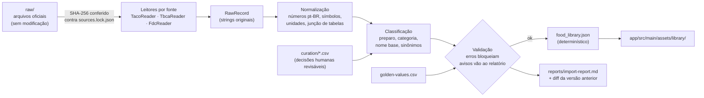

# 3. Biblioteca nutricional inicial

> **Nenhum valor nutricional foi digitado nesta fase.** Este documento define *como* a biblioteca será construída e verificada na Fase 2: fontes, permissões, regras de normalização, validação e importação no app.

## 3.1 Fontes e ordem de prioridade

| Prioridade | Fonte | Papel | Escopo na v1 |
|---|---|---|---|
| 1 | **TACO** — Tabela Brasileira de Composição de Alimentos, 4ª ed. revisada e ampliada (NEPA/UNICAMP, 2011) | Base principal: dados analíticos de alimentos consumidos no Brasil, com preparo explícito no nome | **Tabela completa** (todos os itens da 4ª edição) |
| 2 | **TBCA** — Tabela Brasileira de Composição de Alimentos (FoRC/USP), versão 7.x | Complemento para lacunas da TACO (itens e preparos ausentes) | **Só uma lista curada de lacunas**, e só depois de confirmar as condições de uso (§3.2) |
| 3 | **USDA FoodData Central** — SR Legacy e Foundation Foods (USDA ARS) | Último recurso para itens sem equivalente nas tabelas brasileiras | Só uma lista curada, marcada como "referência internacional" |
| — | **Rótulo do produto** | Produtos de marca (whey, iogurte proteico, granola de marca) | Não entra na biblioteca. O usuário cadastra pelo fluxo "Criar a partir do rótulo". |

Princípios:
- **Fonte brasileira primeiro.** Um mesmo alimento não é importado de duas fontes. Se a TACO tem o item no preparo desejado, a TBCA e o USDA não são usados para ele. Isso evita resultados duplicados na busca.
- **Valores copiados exatamente da fonte.** Nada é arredondado, recalculado ou "corrigido". Nutriente ausente na fonte fica `NULL`.
- **Cada alimento identifica sua fonte** (`data_source`), o código original (`sourceCode`) e a descrição original (`sourceDescription`). A tela de detalhe mostra a citação completa.
- **Itens genéricos não viram média.** "Carne bovina magra" não tem composição única. A busca por esse termo leva, via sinônimos, aos cortes magros reais (patinho, coxão mole, lagarto, filé mignon, miolo de alcatra), e o usuário escolhe um deles.

## 3.2 Condições de uso e redistribuição

Pesquisa feita em 10/11/2026. Os sites oficiais (`nepa.unicamp.br`, `tbca.net.br`, `fdc.nal.usda.gov`) **estão bloqueados pela política de rede deste ambiente de desenvolvimento**, então a verificação usou cópias e índices públicos. As confirmações pendentes são **pré-requisito da Fase 2** (§3.10).

| Fonte | O que foi encontrado | Status | Consequência |
|---|---|---|---|
| TACO 4ª ed. | A página de créditos da publicação diz: *"É permitida a reprodução total ou parcial desta obra, desde que citada a fonte."* (cópia da 4ª ed. hospedada no e-Disciplinas/USP). | Permissão clara. **Confirmar no PDF oficial baixado do NEPA.** | Pode ser incorporada integralmente, com citação. |
| TBCA 7.x | Um documento oficial da TBCA (*Tabelas Complementares — Resposta glicêmica*, versão 7.2, 2023) traz licença **Creative Commons BY-NC-ND 4.0** e a citação sugerida "Tabela Brasileira de Composição de Alimentos (TBCA). Universidade de São Paulo (USP). Food Research Center (FoRC). Versão 7.2. São Paulo, 2023". Uma página do site menciona versão 7.3. **Não foi possível ler o termo de uso da base on-line.** | **Pendente.** Não se sabe se a licença do documento cobre a base de dados. | Uso **condicional** (ver abaixo). |
| USDA FoodData Central | Dados em domínio público sob **CC0 1.0**. O USDA pede citação: "U.S. Department of Agriculture, Agricultural Research Service. FoodData Central, 2019. fdc.nal.usda.gov." | Permissão clara. | Pode ser incorporado, com citação. |

**Regras para a TBCA**, se a licença BY-NC-ND se aplicar à base:
- **BY:** citar a TBCA, a versão e a data de acesso em cada alimento e na tela "Fontes e licenças".
- **NC:** o Calories é pessoal e sem fins comerciais, sem venda nem anúncios. Se isso mudar, a TBCA precisa sair ou ser licenciada.
- **ND:** os valores são reproduzidos sem modificação. A CC 4.0 (§2(a)(4)) permite mudar o formato (de página web para JSON e SQLite), mas não permite recalcular, arredondar ou combinar valores da TBCA com outros.
- A importação fica **restrita à lista de lacunas**, para reduzir a dependência dessa fonte.
- Se o termo de uso da base proibir a incorporação, os itens TBCA saem da lista. A lacuna passa para o USDA ou para cadastro pelo rótulo. Basta remover as linhas `TBCA7` da lista de inclusão e regerar o asset.
- Também é possível pedir autorização à equipe da TBCA pelo contato oficial (tbca.contato@usp.br).

Isto é uma análise técnica de licenças, **não um parecer jurídico**.

### Citações que aparecerão no app

- NÚCLEO DE ESTUDOS E PESQUISAS EM ALIMENTAÇÃO — NEPA. *Tabela Brasileira de Composição de Alimentos — TACO*. 4. ed. rev. e ampl. Campinas: NEPA/UNICAMP, 2011. 161 p.
- *Tabela Brasileira de Composição de Alimentos (TBCA)*. Universidade de São Paulo (USP). Food Research Center (FoRC). Versão 7.x. São Paulo. Acesso em: ‹data›. (Versão e data exatas registradas no `sources.lock.json`.)
- U.S. Department of Agriculture, Agricultural Research Service. *FoodData Central*. fdc.nal.usda.gov. (Conjunto de dados e data de publicação exatos registrados no `sources.lock.json`.)

## 3.3 Características das fontes que afetam a modelagem

Os itens abaixo serão **confirmados no texto metodológico oficial de cada fonte** no início da Fase 2. O importador só será finalizado depois disso.

| Tema | Tratamento previsto |
|---|---|
| **Base de referência** | TACO e TBCA informam valores por **100 g de parte comestível**, inclusive bebidas como leite e suco. Assim, `referenceUnit = GRAM` para a biblioteca, e mililitros só são aceitos com densidade documentada (ver 04, §4.4). |
| **Carboidrato** | Na TACO, o carboidrato é calculado **por diferença** e inclui a fibra. A TBCA publica "carboidrato total" e "carboidrato disponível". O USDA publica "Carbohydrate, by difference". O app usa **carboidrato total** em todas as fontes, para ficarem comparáveis, e registra a base em `data_source.carbohydrateBasis`. O "carboidrato disponível" da TBCA não é usado na v1. |
| **Símbolos** | "Tr" (traço): gravado como 0 com bit em `traceMask`, exibido como "Tr". "NA" (não aplicável): 0 com bit em `notApplicableMask`, exibido como "NA". Asterisco, traço ou vazio (não analisado ou em análise): `NULL`. Qualquer outro símbolo **interrompe** a importação até ser classificado. |
| **Gordura saturada** | Na TACO, os ácidos graxos estão numa tabela separada da composição centesimal. O importador junta as duas pelo número do item. Item sem linha de ácidos graxos fica com `saturatedFatG = NULL`. |
| **Energia** | Importada como publicada (kcal), nunca recalculada. A TACO também publica kJ, o que permite um teste de transcrição: kcal × 4,184 deve bater com o kJ (§3.7). |
| **Sódio** | mg/100 g, como na fonte. |
| **Preparo** | Na TACO, o preparo faz parte do nome ("…, cru", "…, cozido", "…, grelhado"). Cada preparo é um **registro separado**. O importador nunca mescla preparos. |

## 3.4 Pipeline reproduzível de importação



Execução: `./gradlew :tools:food-importer:run`. O comando:

1. **Confere a integridade.** Cada arquivo em `nutrition-data/raw/` precisa ter o SHA-256 registrado em `sources.lock.json` (URL, data de acesso, versão e licença). Arquivo divergente interrompe a execução.
2. **Lê cada fonte.**
   - **TACO:** usa a planilha oficial do NEPA, se publicada. Se houver só o PDF, as tabelas são extraídas uma vez com `tabula-java` (MIT, JVM). O CSV extraído é commitado em `raw/taco-4ed/extracted/` com o comando usado. Uma transcrição comunitária independente pode ser usada **só para comparação** (dupla digitação): toda divergência é resolvida olhando o PDF e registrada.
   - **TBCA:** se não houver download oficial em lote, os itens da lista de lacunas são transcritos da página de cada alimento para `raw/tbca-7.x/manual/<código>.csv`, com URL e data de acesso. Uma segunda transcrição independente é comparada antes de aceitar. **Não haverá raspagem automática do site.**
   - **USDA:** usa os CSVs oficiais (SR Legacy e Foundation). Nutrientes por número: energia 1008 (ou 2047/2048 nos Foundation), proteína 1003, lipídios 1004, carboidrato por diferença 1005, fibra 1079, sódio 1093, saturados 1258.
3. **Normaliza.**
   - Converte vírgula decimal.
   - Mapeia símbolos (§3.3).
   - Converte unidades para g, mg e kcal.
   - Junta as tabelas da TACO.
   - Preserva a string original para o relatório.
4. **Classifica** o preparo, a categoria, o nome base e os sinônimos (§3.5), usando os arquivos de `curation/`.
5. **Valida** (§3.7).
6. **Emite** `food_library.json`:
   - Ordenado por `sourceKey`.
   - Números em notação decimal simples.
   - Sem carimbo de tempo no conteúdo.
   
   Rodar duas vezes gera **bytes idênticos**. A verificação de CI regenera o asset e falha se `git diff` não estiver vazio. O `libraryVersion` (em `curation/library-version.txt`) aumenta sempre que o conteúdo muda.
7. **Gera o relatório**: contagem por fonte, categoria e preparo; avisos; e o diff contra a versão anterior (alimentos adicionados, removidos e com valores alterados).

### Formato do asset (estrutura; valores são marcadores, não dados)

```json
{
  "formatVersion": 1,
  "libraryVersion": 1,
  "sources": [
    { "code": "TACO4", "name": "Tabela Brasileira de Composição de Alimentos — TACO",
      "edition": "4ª ed. rev. e ampl.", "publisher": "NEPA/UNICAMP", "year": 2011,
      "license": "Reprodução permitida desde que citada a fonte",
      "citation": "NEPA. TACO. 4. ed. ...", "carbohydrateBasis": "TOTAL_BY_DIFFERENCE" }
  ],
  "foods": [
    {
      "key": "TACO4:<nº do item>",
      "source": "TACO4",
      "sourceCode": "<nº do item>",
      "sourceDescription": "<descrição exatamente como na tabela>",
      "sourceGroup": "<grupo da tabela>",
      "name": "<nome de exibição>",
      "baseName": "<nome sem o preparo>",
      "aliases": ["<sinônimo>"],
      "category": "PROTEINS",
      "preparation": "GRILLED",
      "reference": { "amount": 100, "unit": "GRAM" },
      "nutrients": {
        "energyKcal":    { "value": "<valor>" },
        "proteinG":      { "value": "<valor>" },
        "carbohydrateG": { "status": "NOT_APPLICABLE" },
        "fatG":          { "value": "<valor>" },
        "saturatedFatG": { "value": "<valor>" },
        "fiberG":        { "status": "NOT_APPLICABLE" },
        "sodiumMg":      { "status": "TRACE" }
      },
      "portions": []
    }
  ]
}
```

`status` pode ser `MEASURED` (padrão quando há `value`), `TRACE`, `NOT_APPLICABLE` ou `NOT_AVAILABLE`.

## 3.5 Classificação

### Preparo (`Preparation`)

| Enum | Exibição | Exemplos de termos no nome da fonte |
|---|---|---|
| `RAW` | Cru | cru, crua, in natura, fresco |
| `COOKED` | Cozido | cozido, cozida, cozido com sal |
| `GRILLED` | Grelhado | grelhado, grelhada |
| `ROASTED` | Assado | assado, assada, ao forno |
| `FRIED` | Frito | frito, frita |
| `SAUTEED` | Refogado | refogado, refogada |
| `TOASTED` | Torrado | torrado, torrada |
| `CANNED` | Em conserva | conserva, em óleo, enlatado |
| `DRIED` | Seco ou em pó | desidratado, em pó, seco |
| `READY_TO_EAT` | Pronto para consumo | pães, laticínios, óleos, açúcar, bebidas (sem estado de preparo aplicável) |
| `PREPARED_DISH` | Preparação culinária | receitas e pratos prontos |

- A classificação é feita por termos e, quando ambígua, pelo arquivo `curation/preparation-overrides.csv`.
- **A saída não pode conter preparo indefinido.** Item sem classificação interrompe a importação.
- O **nome base** (descrição sem o termo de preparo, ex.: "Frango, peito, sem pele") permite agrupar variações na busca: um resultado "Peito de frango sem pele" com os botões **Cru · Cozido · Grelhado**. Cada botão aponta para um registro diferente. Assim a escolha do preparo é sempre explícita.

### Categoria do app

O grupo original da fonte é preservado em `sourceGroup` e pode ser usado como filtro. A categoria do app (os cinco grupos do requisito) vem de `curation/category-map.csv`, com exceções por item:

| Grupo TACO (a confirmar na Fase 2) | Categoria padrão | Exceções previstas |
|---|---|---|
| Carnes e derivados; Pescados e frutos do mar; Ovos e derivados | Proteínas | — |
| Leite e derivados | Proteínas (leite, iogurte e queijos estão em "Proteínas" no requisito) | Creme de leite e similares → Gorduras |
| Cereais e derivados; Leguminosas e derivados | Carboidratos | Derivados de soja ricos em proteína → Proteínas |
| Frutas e derivados | Carboidratos (como no requisito) | Abacate e coco → Gorduras |
| Verduras, hortaliças e derivados | Vegetais e legumes | Batata, batata-doce, mandioca, inhame e cará → Carboidratos |
| Gorduras e óleos; Nozes e sementes | Gorduras | — |
| Bebidas; Produtos açucarados; Miscelâneas; Industrializados; Alimentos preparados | Outros | — |

A categoria serve para organizar a lista. **Não é uma afirmação nutricional.** Os macronutrientes de cada alimento estão sempre visíveis.

### Sinônimos (`aliases`)

Termos regionais e populares, mantidos em `curation/aliases.csv`. Exemplos:
- aipim e macaxeira → mandioca
- castanha-do-pará → castanha-do-Brasil
- carne magra → cortes magros
- abobrinha → abobrinha italiana
- frango grelhado → peito grelhado

## 3.6 Importação no app (seed)

`LibrarySeeder`, chamado na inicialização do app:

```
assetVersion = cabeçalho do asset (libraryVersion, sha256)
installed    = app_meta['library.version'] ou 0
se assetVersion > installed:
    em UMA transação:
        upsert de data_source por code
        upsert de food_category de sistema por code
        para cada alimento do asset:
            se sourceKey existe → UPDATE só das colunas de origem (preserva id)
            senão               → INSERT (origin = 'LIBRARY')
        UPDATE food SET isDeprecated = 1
            WHERE origin = 'LIBRARY' AND sourceKey NOT IN (chaves do asset)
        substitui as porções da biblioteca (isUserDefined = 0) dos itens tocados
        app_meta['library.version'] = assetVersion
```

O que isso garante:
- **Sem duplicação:** a chave é `sourceKey` (UNIQUE), nunca o nome.
- **Idempotência:** rodar duas vezes não muda nada (testado).
- **Isolamento:** linhas `CUSTOM`, `food_usage` (favoritos), diário, planos e metas não são tocados.
- **Histórico preservado:** se um valor mudar numa versão nova da biblioteca, os registros antigos continuam com o snapshot antigo. Só os próximos registros usam o valor novo.
- **Atomicidade:** se o processo morrer no meio, a transação é desfeita e a importação recomeça na próxima abertura.
- **Desempenho:** inserção em lote numa transação. O asset é lido em *streaming* com `kotlinx.serialization`.

## 3.7 Validação e garantia de qualidade

| Código | Regra | Severidade |
|---|---|---|
| E1 | `sourceKey` duplicado | Erro |
| E2 | Arquivo bruto com SHA-256 diferente do `sources.lock.json` | Erro |
| E3 | Símbolo desconhecido ou número inválido | Erro |
| E4 | Valor negativo; proteína, gordura ou carboidrato > 100 g/100 g; sódio > 40.000 mg/100 g | Erro |
| E5 | Gordura saturada > gordura total (tolerância de 0,1 g) | Erro |
| E6 | Preparo ou categoria não classificados | Erro |
| E7 | Divergência com `golden-values.csv` | Erro |
| E8 | TACO: kcal × 4,184 diverge do kJ publicado além do arredondamento (indica coluna trocada na extração) | Erro, salvo exceção registrada após conferência manual |
| E9 | TACO: umidade + proteína + lipídios + carboidrato + cinzas ≠ 100 g além do arredondamento (o carboidrato é por diferença, então a soma fecha em 100) | Erro, salvo exceção registrada |
| W1 | Energia diverge mais de 15% de 4·P + 4·C + 9·G (normal com álcool, fibra elevada ou fatores específicos) | Aviso. **O valor nunca é corrigido.** |
| W2 | Fibra > carboidrato total | Aviso |
| W3 | Nutriente opcional ausente | Aviso (contado no relatório) |
| W4 | Nome normalizado parecido com o de outra fonte (possível duplicata) | Aviso |

**Valores de ouro (`golden-values.csv`):** para cada alimento da lista inicial (§3.8) e para uma amostra aleatória de 5% dos demais, uma pessoa confere os valores diretamente na página do PDF oficial e registra fonte, página e valor. O teste do importador compara a saída com esse arquivo. Isso garante que extração, junção de tabelas e mapeamento de colunas estão corretos.

## 3.8 Cobertura da lista inicial do requisito

> **Expectativa de cobertura, não verificada.** Baseia-se no conhecimento prévio da estrutura da TACO 4ª ed. e será confirmada item a item contra o arquivo oficial na Fase 2. As descrições abaixo indicam o que procurar. Não são nomes oficiais confirmados, e não há valores nesta tabela.

Legenda:
- ✅ esperado na TACO.
- 🔶 a confirmar, possível lacuna na TACO: buscar na TBCA e depois no USDA.
- 🔷 não é um item de tabela: tratado por sinônimos ou por escolha do usuário.
- 🏷️ produto de marca: cadastro pelo rótulo é o mais preciso.

**Proteínas**

| Pedido | Preparos esperados | Status |
|---|---|---|
| Peito de frango | com e sem pele; cru, cozido, grelhado | ✅ |
| Coxa de frango | com e sem pele; crua, cozida, assada | ✅ |
| Carne bovina magra | — | 🔷 sinônimo para cortes magros reais |
| Patinho | cru, grelhado | ✅ |
| Acém | cru, cozido, moído | ✅ |
| Alcatra | cru, grelhado (a TACO deve listar como "miolo de alcatra") | ✅ confirmar o nome |
| Carne moída | corte moído (ex.: acém moído), cru e cozido | 🔷 a composição depende do corte; o usuário escolhe |
| Tilápia | crua, grelhada | 🔶 |
| Salmão | cru, grelhado | ✅ |
| Atum | fresco cru; em conserva | ✅ |
| Sardinha | crua, assada, frita, em conserva | ✅ |
| Ovo inteiro | cru, cozido, frito | ✅ |
| Clara de ovo | cozida (crua a confirmar) | ✅ |
| Leite | integral, desnatado (por 100 g) | ✅ |
| Iogurte natural | integral, desnatado | ✅ |
| Queijo cottage | — | 🔶 |
| Whey protein | pó | 🔶🏷️ a composição varia muito entre concentrado, isolado e marcas: o rótulo é recomendado; o genérico do USDA fica identificado como tal |

**Carboidratos**

| Pedido | Preparos esperados | Status |
|---|---|---|
| Arroz branco | cru, cozido | ✅ |
| Arroz integral | cru, cozido | ✅ |
| Feijão carioca | cru, cozido | ✅ |
| Feijão preto | cru, cozido | ✅ |
| Batata inglesa | crua, cozida, frita | ✅ |
| Batata-doce | crua, cozida | ✅ |
| Mandioca | crua, cozida, frita | ✅ |
| Macarrão | cru ✅; cozido 🔶 | ✅/🔶 |
| Aveia | flocos | ✅ |
| Pão francês | — | ✅ |
| Pão integral | pão de forma integral | ✅ |
| Tapioca | goma hidratada; tapioca preparada | 🔶 |
| Cuscuz | cuscuz de milho cozido; cuscuz paulista | ✅ |
| Banana | variedades (prata, nanica, maçã…), crua | ✅ |
| Maçã | variedades, crua | ✅ |
| Mamão | formosa, papaia | ✅ |
| Laranja | variedades, crua | ✅ |

**Gorduras**

| Pedido | Preparos esperados | Status |
|---|---|---|
| Azeite de oliva | extravirgem | ✅ |
| Pasta de amendoim | — | 🔶🏷️ |
| Amendoim | cru, torrado | ✅ |
| Castanha-do-pará | crua (na TACO deve aparecer como "castanha-do-Brasil") | ✅ via sinônimo |
| Castanha-de-caju | torrada | ✅ |
| Abacate | cru | ✅ |
| Manteiga | com sal, sem sal | ✅ |
| Óleo de soja | — | ✅ |

**Vegetais e legumes**

| Pedido | Preparos esperados | Status |
|---|---|---|
| Alface | variedades, crua | ✅ |
| Tomate | cru; derivados (extrato, molho) | ✅ |
| Cenoura | crua, cozida | ✅ |
| Brócolis | cru, cozido | ✅ |
| Couve | crua, refogada | ✅ |
| Abobrinha | crua, cozida, refogada | ✅ |
| Pepino | cru | ✅ |
| Beterraba | crua, cozida | ✅ |
| Espinafre | cru, refogado | ✅ |
| Repolho | branco e roxo; cru, refogado | ✅ |

**Outros**

| Pedido | Preparos esperados | Status |
|---|---|---|
| Café | infusão; pó | ✅ |
| Açúcar | refinado, cristal, mascavo | ✅ |
| Mel | — | ✅ |
| Chocolate amargo | a TACO deve ter "meio amargo", que **não** é o mesmo que amargo 70%. Os dois não serão confundidos. | ✅ meio amargo / 🔶 amargo |
| Iogurte proteico | — | 🏷️ sem equivalente genérico em tabela |
| Granola | — | 🔶🏷️ a composição varia muito por marca |
| Suco de laranja | suco natural (por 100 g) | ✅ |
| Água de coco | — | 🔶 |

**Volume esperado na v1:** a TACO completa (597 itens, segundo a descrição da 4ª edição; contagem a confirmar no arquivo), mais algumas dezenas de itens de lacuna da TBCA e do USDA. É o suficiente para o app nunca abrir vazio. A estrutura (asset versionado, `sourceKey`, *upsert*) comporta dezenas de milhares de itens sem mudar o esquema.

## 3.9 Medidas caseiras e densidades (opcional)

- **Medidas caseiras** ("1 colher de sopa", "1 unidade média") só entram com fonte documentada. A candidata é a tabela de medidas referidas da POF/IBGE. Licença e conteúdo serão verificados antes de usar. Sem fonte, o alimento aceita apenas g (ou ml).
- **Densidade (g/ml)** para registrar líquidos em ml: só com dado documentado, como a massa de uma medida de volume publicada no USDA FDC, com a origem guardada em `densitySource`. Sem densidade, o leite da TACO é registrado em gramas, e a interface explica o motivo.
- O usuário pode criar suas próprias porções ("minha concha = 140 g") a qualquer momento.

## 3.10 Pré-requisitos para iniciar a Fase 2

1. **Acesso aos arquivos oficiais.** Este ambiente bloqueia `nepa.unicamp.br`, `tbca.net.br` e `fdc.nal.usda.gov`. Há duas saídas:
   - (a) liberar esses domínios na configuração de rede do ambiente; ou
   - (b) baixar os arquivos e colocá-los em `nutrition-data/raw/` (ver [nutrition-data/README.md](../nutrition-data/README.md)).
2. **Confirmar os termos de uso da TBCA** (§3.2), no site ou pelo contato oficial, antes de incluir qualquer item TBCA.
3. **Confirmar o texto de permissão e a metodologia da TACO** (símbolos, base do carboidrato, tabela de ácidos graxos) no PDF oficial.
