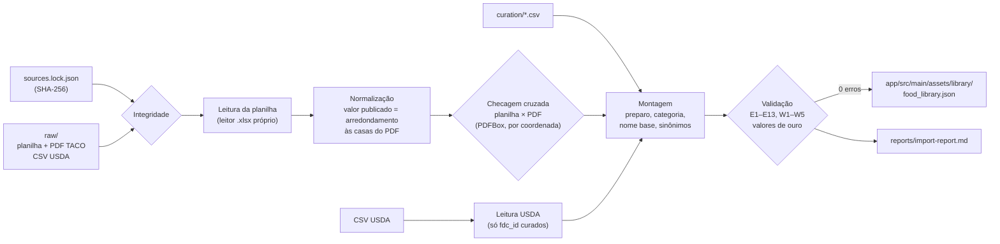

# 3. Biblioteca nutricional

> **Fase 2 concluída.** A biblioteca inicial tem **611 alimentos**: os 597 itens da TACO 4ª edição completa e 14 itens do USDA que cobrem lacunas da TACO.
>
> - Os valores vêm dos arquivos oficiais, sem nenhum valor digitado à mão.
> - Nada foi arredondado nem recalculado além do que a própria fonte publica.
> - Tudo é reproduzível com `./gradlew :tools:food-importer:generateFoodLibrary`.
>
> O relatório completo da última importação está em [`nutrition-data/reports/import-report.md`](../nutrition-data/reports/import-report.md).

## 3.1 Fontes usadas

| Fonte | Arquivos oficiais (versionados em `nutrition-data/raw/`) | Papel | Itens |
|---|---|---|---|
| **TACO**: Tabela Brasileira de Composição de Alimentos, 4ª ed. revisada e ampliada (NEPA/UNICAMP, 2011) | Planilha `Taco-4a-Edicao.xlsx` e PDF `taco_4_edicao_ampliada_e_revisada.pdf`, ambos do site do NEPA | Base principal | 597 (tabela completa) |
| **USDA FoodData Central**: SR Legacy (abril de 2018) | `FoodData_Central_sr_legacy_food_csv_2018-04.zip` | Só lacunas da TACO, marcadas como "referência internacional" | 14 |
| **TBCA** (FoRC/USP) | — | **Não usada** (§3.2) | 0 |

URLs, data de acesso e SHA-256 de cada arquivo estão em [`nutrition-data/sources.lock.json`](../nutrition-data/sources.lock.json). O importador recusa qualquer arquivo cujo hash não confira.

## 3.2 Condições de uso, verificadas nos documentos oficiais

| Fonte | Texto oficial | Decisão |
|---|---|---|
| TACO | PDF oficial, p. ii: *"Tabela Brasileira de Composição de Alimentos – TACO é uma publicação do NEPA. É permitida a reprodução total ou parcial do material, desde que seja citada a fonte."* | ✅ Incorporada integralmente, com citação. |
| USDA FDC | fdc.nal.usda.gov: *"USDA FoodData Central data are in the public domain and they are not copyrighted. They are published under CC0 1.0 Universal (CC0 1.0)."* O USDA pede citação. | ✅ Incorporado para as lacunas, com citação. |
| TBCA 7.3 (2025) | tbca.net.br, "Como citar": *"É estimulada a divulgação de dados, sem fins comerciais, sendo necessário citar a fonte"* e também *"Não é permitida a reprodução total ou parcial do material. […] Não é permitida a comercialização. Não é permitido a alteração total ou mesmo parcial do conteúdo."* A obra está registrada como direito autoral. | ❌ Não incorporada. |

**Por que a TBCA ficou de fora:** este repositório é **público**. Gravar valores da TBCA no asset seria reprodução pública de parte do material, o que o termo proíbe expressamente, mesmo sem fins comerciais.

O uso pessoal da informação, com citação, é permitido. Se quiser algum alimento que só existe na TBCA, você pode cadastrá-lo como **alimento personalizado** no app, informando "TBCA" como fonte. Outra saída é tornar o repositório privado e pedir autorização à equipe da TBCA (tbca.contato@usp.br).

Isto é uma leitura técnica dos termos, não um parecer jurídico.

### Citações exibidas no app

- NÚCLEO DE ESTUDOS E PESQUISAS EM ALIMENTAÇÃO – NEPA. *Tabela Brasileira de Composição de Alimentos – TACO*. 4. ed. rev. e ampl. Campinas: NEPA/UNICAMP, 2011. 161 p.
- U.S. Department of Agriculture, Agricultural Research Service, Beltsville Human Nutrition Research Center. *FoodData Central: SR Legacy (2018-04)*. Disponível em: https://fdc.nal.usda.gov/. Acesso em: 10 nov. 2026.

## 3.3 Metodologia das fontes (confirmada no texto oficial)

| Tema | O que a TACO diz (PDF oficial) | Tratamento no Calories |
|---|---|---|
| Base | Tabelas "por 100 gramas de parte comestível" | `reference = 100 GRAM` para todos os itens, inclusive bebidas (ver 04, §4.4 sobre ml) |
| Carboidrato | *"calculado pela diferença entre 100 e a soma das porcentagens de água, proteína, lipídeos totais, cinzas e álcool […] incluem a fibra alimentar total"* | Exibido como **carboidrato total**. Na USDA a base é a mesma ("Carbohydrate, by difference"). |
| Energia | *"sistema Atwater, utilizando os coeficientes específicos […] Para o álcool, 6,93 kcal/g"* | Usada como publicada. Por isso 4P + 4C + 9G pode divergir: são 42 avisos W1, todos mantidos. |
| `Tr` | Traço: valor arredondado para zero ou abaixo do limite de quantificação | `TRACE`: exibido "Tr", soma 0 |
| `NA` | Não aplicável | `NOT_APPLICABLE`: exibido "NA", soma 0 |
| `*` | *"as análises estão sendo reavaliadas"* | `NOT_AVAILABLE` + observação |
| Célula em branco | *"análises não solicitadas"* | `NOT_AVAILABLE`: exibido "—", torna o total "parcial" |
| Gordura saturada | Tabela 2 (ácidos graxos), separada; 423 dos 597 itens | Junção pelo número do item. Itens sem análise ficam sem dado, salvo quando os lipídios totais são traço (então a saturada também é traço, com observação). |

## 3.4 Pipeline de importação



Comandos:

```bash
./gradlew :tools:food-importer:generateFoodLibrary
```

```bash
./gradlew :tools:food-importer:verifyFoodLibrary
```

```bash
./gradlew test
```

- `generateFoodLibrary` gera o asset e o relatório.
- `verifyFoodLibrary` falha se o asset commitado for diferente do que seria gerado.
- `./gradlew test` roda 41 testes, inclusive a integração com os arquivos reais.

### Valor publicado (TACO)

A planilha oficial guarda médias **sem arredondamento** (ex.: 123,53489 kcal), e o PDF publica a tabela arredondada (124 kcal). O Calories usa o **valor publicado**:
1. Arredonda a 12 algarismos significativos, para eliminar ruído de ponto flutuante da planilha (0,6499999999999999 → 0,65).
2. Arredonda `HALF_UP` nas casas usadas pelo PDF:

| Coluna | Casas |
|---|---|
| Energia | 0 |
| Proteína, lipídios, carboidrato, fibra, saturada | 1 |
| Sódio | 0 |

Carboidratos por diferença levemente negativos aparecem nas análises de três carnes. A TACO os publica como 0,0, e o app os importa como 0,0 com uma observação.

### Checagem cruzada entre os dois arquivos oficiais

Cada valor usado pelo app, depois de arredondado, é comparado com o número impresso no PDF:
- O texto do PDF é lido com PDFBox.
- Cada número é atribuído à coluna cujo rótulo de unidade ("(kcal)", "(mg)"…) está mais próximo na horizontal.
- Assim, células vazias não deslocam colunas.

**Resultado da última execução:**

| Campo | Valores comparados | Divergências |
|---|---|---|
| Umidade, energia (kcal e kJ), proteína, lipídios, carboidrato, fibra, cinzas, sódio | 597 × 9 = 5.373 | 0 |
| Gordura saturada (Tabela 2) | 423 | 0 |
| **Total** | **5.796** | **0** |

Linhas não comparáveis: 0. As únicas diferenças entre os dois arquivos são de **descrição** e estão documentadas (§3.6).

### Valores de ouro

Há 213 valores conferidos **por um caminho independente do importador**:
- TACO: 17 alimentos prioritários, extraídos do PDF com `pdftotext` (Poppler), não com PDFBox.
- USDA: os 14 itens, extraídos do dataset **JSON** oficial (o importador lê o CSV).

O JSON do USDA publica 3 algarismos significativos (30,86 no CSV → 30,9 no JSON), por isso esses valores são comparados com tolerância de meia unidade nesse algarismo. Todos conferem.

### Regras de validação

| Código | Regra | Tipo |
|---|---|---|
| E1 | Chave duplicada | Erro |
| E2 | Arquivo bruto ausente ou com SHA-256 divergente | Erro |
| E3 | Símbolo desconhecido ou valor negativo fora do carboidrato por diferença | Erro |
| E4 | Macronutriente > 100 g/100 g; sódio > 40.000 mg/100 g | Erro |
| E5 | Saturada > gordura total + 0,1 g | Erro |
| E6 | Item sem preparo ou categoria definidos | Erro |
| E7 | Valor de ouro divergente | Erro |
| E8 | kcal × 4,184 diverge do kJ em mais de 5 kJ (indica coluna trocada) | Erro |
| E9 | Umidade + proteína + lipídios + carboidrato + cinzas (+ álcool) fora de 100 ± 0,5 g, quando o carboidrato é calculado por diferença (> 0) | Erro |
| E10 | Divergência planilha × PDF não documentada | Erro |
| E11 | Curadoria apontando para chave inexistente, ou divergência documentada que não ocorre mais | Erro |
| E12 | Conteúdo mudou sem incrementar `library-version.txt` | Erro |
| E13 | Mesmo nome base e mesmo preparo em dois itens (escolha ambígua na busca) | Erro |
| W1 | Energia diverge mais de 15% de 4P + 4C + 9G | Aviso (42) |
| W2 | Fibra > carboidrato total | Aviso (7) |
| W5 | Pequena inconsistência kcal/kJ dentro da própria TACO | Aviso (7) |

Nas verificações de consistência da última execução:
- E8 checou 591 itens, com desvio máximo de 1,8 kJ.
- E9 checou 404 itens da TACO (desvio máximo de 0,11 g) e 12 do USDA (0,07 g).

## 3.5 Curadoria (`nutrition-data/curation/`)

Decisões humanas ficam em CSVs revisáveis, sempre com justificativa:

| Arquivo | Conteúdo |
|---|---|
| `categories.csv` | As 5 categorias do app |
| `taco-groups.csv` | Grupo da TACO → categoria padrão e preparo padrão (quando o grupo permite) |
| `category-overrides.csv` | 51 exceções. Exemplos: batata, mandioca e derivados → Carboidratos; abacate e amendoim → Gorduras; cuscuz e tapioca → Carboidratos, como no requisito. |
| `preparation-overrides.csv` | 98 itens cuja descrição não traz palavra de preparo (pães, polpas congeladas, sucos, embutidos, "à milanesa"…). As decisões citam o protocolo do Apêndice 2 da TACO quando ele existe. |
| `aliases.csv` | 80 sinônimos de busca (aipim, macaxeira, castanha-do-pará, carne magra…) |
| `usda-foods.csv` | Os 14 itens do USDA, com nome em português e justificativa |
| `source-corrections.csv` | Correções **de texto** (nunca de valores) |
| `taco-pdf-deviations.csv` | Divergências conhecidas entre planilha e PDF |
| `value-exclusions.csv` | Valores fisicamente impossíveis descartados (viram "sem dado"; nunca substituídos) |
| `taco-alcohol.csv` | Teor alcoólico da nota †† da Tabela 1, usado só na verificação E9 |
| `golden-values.csv` | Valores de ouro |
| `requested-foods.csv` | Mapeamento da lista inicial do requisito → alimentos da biblioteca |
| `library-version.txt` | Versão da biblioteca (o app reimporta quando ela aumenta) |

### Problemas encontrados nas fontes

| Item | Problema | Tratamento |
|---|---|---|
| TACO 540 | A planilha traz a descrição "L"; o PDF traz "Feijoada" (valores iguais nos dois) | Descrição do PDF |
| TACO 69 | O PDF grafa "Abobora" sem acento | Descrição da planilha ("Abóbora") |
| TACO 472, 474 | O marcador de nota de rodapé faz parte da descrição ("Cerveja, pilsen 2") | Marcador removido |
| TACO 368 (maminha grelhada) | 2,4 g de lipídios, mas os ácidos graxos publicados somam 17,6 g (saturada 9,7 g) | Saturada **descartada** (sem dado), com observação no app |
| TACO 251, 252, 256, 292, 492, 559, 594 | kcal × 4,184 difere levemente do kJ publicado (até 1,8 kJ) | Aviso W5; o app usa as kcal publicadas |
| TACO 78, 108, 128, 163, 241, 325, 586 | Fibra publicada maior que o carboidrato total (que deveria incluí-la); são duas medições independentes com margem analítica | Aviso W2; os dois valores são mantidos como publicados |

## 3.6 Classificação

**Preparo:** detectado pela última palavra de preparo na descrição (cru, cozido, grelhado, assado, frito, refogado, torrado, conserva, desidratado/pó), ou definido na curadoria. Distribuição:

| Preparo | Itens |
|---|---|
| Cru | 254 |
| Pronto para consumo | 134 |
| Cozido | 63 |
| Preparação culinária | 37 |
| Frito | 28 |
| Seco ou em pó | 22 |
| Assado | 22 |
| Grelhado | 22 |
| Em conserva | 14 |
| Refogado | 9 |
| Torrado | 6 |

Farinhas, féculas e polvilho são classificados como "Cru", seguindo a própria TACO ("Farinha, de mandioca, crua", "Milho, fubá, cru").

**Nome base:** é a descrição sem o segmento final de preparo. Por exemplo, "Frango, peito, sem pele, grelhado" vira "Frango, peito, sem pele". Ele agrupa as variações de um mesmo alimento (100 grupos), e o usuário escolhe explicitamente **Cru · Cozido · Grelhado**. A regra E13 garante que nenhum grupo tenha dois itens com o mesmo preparo.

**Categoria:** é organização da lista, não afirmação nutricional. O grupo original da TACO fica preservado em `sourceGroup`.

| Categoria | Itens |
|---|---|
| Proteínas | 209 |
| Carboidratos | 214 |
| Gorduras | 35 |
| Vegetais e legumes | 74 |
| Outros | 79 |

## 3.7 Cobertura da lista inicial

Todos os 60 itens do requisito estão mapeados. A tabela completa, com as chaves, está no relatório de importação.

| Situação | Itens |
|---|---|
| ✅ Na TACO | Peito e coxa de frango, patinho, acém, alcatra (miolo), salmão, atum, sardinha, ovo, clara, leite, iogurte natural, arroz branco e integral, feijão carioca e preto, batata, batata-doce, mandioca, aveia, pão francês, pão integral, cuscuz, banana, maçã, mamão, laranja, azeite, amendoim, castanha-do-pará, castanha-de-caju, abacate, manteiga, óleo de soja, os 10 vegetais, café, açúcar, mel, suco de laranja, água de coco |
| 🔷 Sem item único | "Carne bovina magra" (sinônimo para 10 cortes magros) e "carne moída" (acém moído; a composição depende do corte) |
| 🌎 Lacuna na TACO, coberta pelo USDA | Tilápia (crua e cozida), queijo cottage, macarrão cozido, pasta de amendoim, whey protein (genérico), chocolate amargo 60–85% (a TACO tem "meio amargo", que continua disponível) |
| 🏷️ Melhor pelo rótulo | Iogurte proteico (há iogurte grego do USDA como referência, não como equivalente), granola (receita caseira do USDA como referência), goma de tapioca (a TACO tem "Tapioca, com manteiga") |

## 3.8 Importação no app (Fase 3)

O asset `food_library.json` segue o formato definido em `:library-format` (`LibraryAsset`), compartilhado entre o importador e o app. O `LibrarySeeder` da Fase 3 vai:
- importar por `key` (`TACO4:<nº>` ou `USDA_SR:<fdcId>`) numa única transação;
- marcar como `isDeprecated` os itens que saírem da biblioteca;
- nunca tocar em alimentos personalizados, favoritos, diário ou planos;
- gravar `library.version` na mesma transação.

Detalhes em [02-banco-de-dados.md](02-banco-de-dados.md).

## 3.9 Como atualizar a biblioteca

1. Para uma nova versão de um arquivo oficial:
   1. Coloque o arquivo em `nutrition-data/raw/…`.
   2. Atualize URL, data e SHA-256 em `sources.lock.json`.
2. Ajuste a curadoria, se necessário, e incremente `curation/library-version.txt`.
3. Gere o asset e o relatório com `./gradlew :tools:food-importer:generateFoodLibrary`.
4. Revise o relatório: a seção "Diferenças em relação ao asset anterior" lista o que entrou, saiu ou mudou.
5. Rode `./gradlew test` e faça o commit do asset junto com o relatório.
