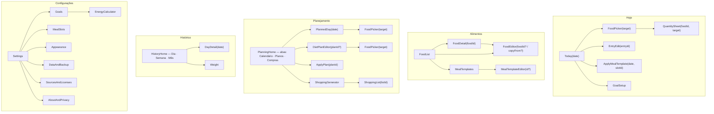
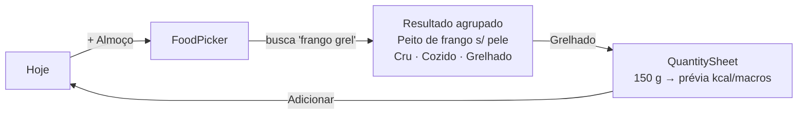
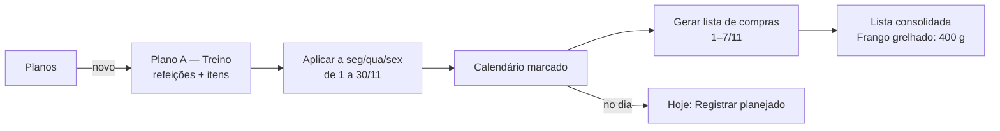

# 5. Navegação, fluxos e interface

## 5.1 Estrutura de navegação

Uma única Activity com `NavHost` e barra inferior de cinco destinos. Cada aba tem seu próprio grafo aninhado e preserva a pilha ao alternar (`saveState`/`restoreState`). As rotas são `@Serializable` (Navigation Compose com rotas tipadas).



`FoodPicker` é **um só componente**, reutilizado por diário, dia planejado, plano e modelo. O destino vem como um tipo selado:

```kotlin
@Serializable sealed interface PickTarget {
    @Serializable data class Diary(val epochDay: Long, val slotId: Long) : PickTarget
    @Serializable data class Planned(val plannedMealId: Long) : PickTarget
    @Serializable data class PlanMeal(val planMealId: Long) : PickTarget
    @Serializable data class Template(val templateId: Long) : PickTarget
}
```

## 5.2 Telas por aba

### 1. Hoje (dashboard)

```
┌──────────────────────────────────────┐
│  ‹  Hoje, ter 10 nov  ›          📅  │  ← DateSwitcher (deslizar troca o dia)
│                                      │
│          ╭───────────╮               │
│        ╱    1.240     ╲              │  ← CalorieRing: consumido / meta
│       │    restantes   │             │     restante no centro; % abaixo
│        ╲  de 2.100    ╱              │
│          ╰───────────╯   59%         │
│                                      │
│  Proteínas   ██████████░░░  92/140 g │  ← MacroBar × 3 (+ fibra compacta)
│  Carboidr.   ██████░░░░░░░ 130/240 g │
│  Gorduras    ███████░░░░░░   38/70 g │
│  Fibras 14/30 g                      │
│                                      │
│  ▾ Café da manhã         420 kcal  + │  ← MealCard (expansível)
│     Pão francês · 50 g      150 kcal │
│     Ovo, cozido · 100 g     146 kcal │
│  ▾ Almoço                820 kcal  + │
│  ▸ Lanche da tarde     planejado   + │  ← planejado: "Registrar" em 1 toque
│  ▸ Jantar                  —       + │
└──────────────────────────────────────┘
```

Valores ilustrativos de layout, não dados nutricionais.

Ações:
- **+ na refeição:** abre o `FoodPicker` → `QuantitySheet` → salva.
- **Toque no item:** editar a quantidade, mover para outra refeição, ver o alimento ou remover (com "Desfazer").
- **Menu da refeição:** salvar como modelo, aplicar modelo, copiar de outro dia, duplicar para outra data, limpar.
- **Menu do dia:** copiar o dia inteiro de outra data, registrar todo o planejamento do dia.
- **Resumo diário** (expansível no fim da tela): calorias, proteínas, carboidratos, gorduras, fibras, gordura saturada e sódio totais, com o indicador "parcial" quando aplicável.

### FoodPicker e QuantitySheet

- **FoodPicker:**
  - Campo de busca focado ao abrir.
  - Abas: **Recentes · Favoritos · Biblioteca · Meus alimentos**.
  - Resultados agrupados por nome base, com botões de preparo (Cru · Cozido · Grelhado).
  - Cada linha mostra a fonte (TACO, USDA, Meu) e kcal/100 g.
- **QuantitySheet** (bottom sheet):
  - Campo numérico pré-preenchido com a última quantidade usada.
  - Unidade: g; ml só com densidade; porções, se houver.
  - Prévia ao vivo de kcal e macros, com uma casa decimal.
  - Botão "Adicionar".

### 2. Alimentos

- **Lista:** busca e filtros (categoria, origem: biblioteca, meus ou favoritos; preparo; fonte). Botão "Novo alimento".
- **Detalhe:**
  - Valores por referência e calculadora de quantidade embutida.
  - Status de cada nutriente (Tr, NA, —).
  - Fonte com citação, código e descrição original.
  - Ações: favoritar, adicionar a uma refeição, **duplicar como personalizado**. "Editar" e "Excluir" aparecem só para personalizados.
- **Editor (personalizado):**
  - Campos: nome, marca, categoria, unidade e quantidade de referência ("valores por 30 g", como no rótulo).
  - Nutrientes: kcal, proteína, carboidrato e gordura obrigatórios; fibra, saturada e sódio opcionais.
  - Porções próprias.
  - Validação em tempo real, com aviso (não bloqueante) se a energia diverge muito de 4P + 4C + 9G, para pegar erro de digitação.
- **Modelos de refeição:** lista e editor de refeições favoritas.

### 3. Planejamento

> **Como ficou na Fase 4 (0.4.0):** abas Calendário, Planos e Compras. O calendário é só a visão de mês (dia com fundo destacado e kcal planejadas; sem cor por plano). Aplicar plano em lote: intervalo + dias da semana, substituir ou somar. "Limpar" é por dia. Planos não têm exportação individual (a exportação de planos fica em Ajustes → Dados e backup e leva todos). A lista de compras sai em ordem alfabética, sem agrupar por categoria, e pode ser compartilhada como texto. O Hoje ganhou um cartão "Planejado para este dia" com atalho para registrar.

- **Calendário:**
  - Visões de mês e de semana. Cada dia mostra um marcador com a cor do plano aplicado e as kcal planejadas.
  - Toque no dia abre o **Dia planejado**: mesma estrutura visual do Hoje, com refeições planejadas e totais comparados à meta.
  - Ações em lote: aplicar plano a datas ou dias da semana (ex.: Plano A em seg/qua/sex de novembro), copiar dia, limpar intervalo.
- **Planos:** lista ("Plano A — Dias de treino", "Plano B — Descanso", "Plano C — Fim de semana"…), com editor de refeições e itens. Totais do plano aparecem ao vivo. Ações: duplicar plano e exportar.
- **Compras:**
  - Gerador: intervalo de datas e slots → lista consolidada.
  - Lista: itens agrupados por categoria, com checkbox, edição de quantidade, item manual e "limpar comprados".

### 4. Histórico

> **Como ficou na Fase 4:** abas Consumo e Peso. Consumo tem Semana e Mês (o "Dia" é o próprio Hoje, aberto ao tocar num dia da lista; o Hoje tem seletor de data para qualquer dia passado). O gráfico de macros mostra a % da energia de cada dia; as barras de progresso mostram as médias em gramas contra as metas.

- **Dia, Semana e Mês** (seletor segmentado) e navegação por período.
- Gráficos:
  - Barras de kcal por dia com a linha da meta vigente.
  - Barras empilhadas de macros (g ou % da energia).
  - Médias do período, contando só os dias registrados.
- **Lista de dias:** consumo × meta e diferença. Toque abre o **DayDetail**, que pode ser editado: corrigir registros passados é permitido.
- **Peso:** gráfico de linha, média móvel de 7 registros (opcional), lista e registro rápido.
- Seletor de data para ir a qualquer dia passado.

### 5. Configurações

- **Metas:** valores atuais e "vigente desde"; botão para a calculadora.
- **Calculadora** (ver 04, §4.7).
- **Refeições:** renomear, reordenar, horário, ativar ou desativar, lembrete.
- **Aparência:** tema (sistema, claro, escuro) e Material You (cores do papel de parede).
- **Dados:** exportar CSV, exportar JSON, criar backup, restaurar, exportar planos, backup automático em pasta. *(Fase 4: tudo pelo seletor de arquivos do sistema, menos o backup automático, que não entrou; o backup completo JSON cumpre o papel de "exportar JSON". Lembretes por refeição também não entraram.)*
- **Fontes e licenças:** citações TACO e USDA, versão da biblioteca e licenças das bibliotecas de código aberto.
- **Sobre e privacidade:** sem internet, sem conta, sem anúncios, dados só no aparelho.

## 5.3 Fluxos principais





## 5.4 Diretrizes visuais

- **Material 3**, tema próprio claro e escuro. Material You é opcional.
- **Tipografia:** fonte do sistema (Roboto ou a fonte do One UI). Escala M3, com números em `tabular figures` para alinhar colunas de valores.
- **Cores semânticas fixas:** proteína, carboidrato, gordura e fibra têm sempre a mesma cor em barras, gráficos e chips, com contraste conferido nos dois temas (WCAG AA para texto). A cor nunca é o único canal de informação: rótulos e valores sempre acompanham.
- **Hierarquia:** um número dominante por tela (kcal restantes no Hoje); o restante é secundário. Tela de detalhe só quando necessária.
- **Gráficos discretos:** sem grade pesada nem 3D. Linha de meta tracejada. Toque numa barra mostra o valor.
- **Animações:** progresso do anel e das barras com `animateFloatAsState` (cerca de 300 ms), expansão de cartões com `AnimatedVisibility` e transição de data com `AnimatedContent`. Todas respeitam a configuração de redução de animações do sistema.
- **Edge-to-edge e predictive back** (Android 16).
- **Acessibilidade:**
  - Alvos de toque de pelo menos 48 dp.
  - `contentDescription` em ícones e gráficos (resumo textual do gráfico).
  - Suporte a fonte grande sem cortar valores.
  - Ordem de foco lógica no TalkBack.
- **Estados vazios** úteis: sem meta → "Definir meta"; dia vazio → "Adicionar café da manhã" ou "Copiar de ontem".

## 5.5 Componentes reutilizáveis (`:app/ui/components`)

| Componente | Usado em |
|---|---|
| `CalorieRing` | Hoje, Dia planejado, DayDetail |
| `MacroBar` / `MacroSummaryRow` | Hoje, Dia planejado, Plano, Histórico |
| `MealCard` / `FoodEntryRow` | Hoje, Dia planejado, Plano, Modelo |
| `NutrientTable` (com Tr, NA, — e "parcial") | Detalhe do alimento, Resumo diário |
| `FoodListItem` (com `SourceBadge` e `PreparationChip`) | FoodPicker, lista de Alimentos |
| `QuantityInput` | QuantitySheet, editores |
| `DateSwitcher` | Hoje, Histórico |
| `PeriodBarChart`, `StackedMacroChart`, `LineChart` | Histórico, Peso |
| `ConfirmDialog`, `UndoSnackbar`, `EmptyState` | Geral |
